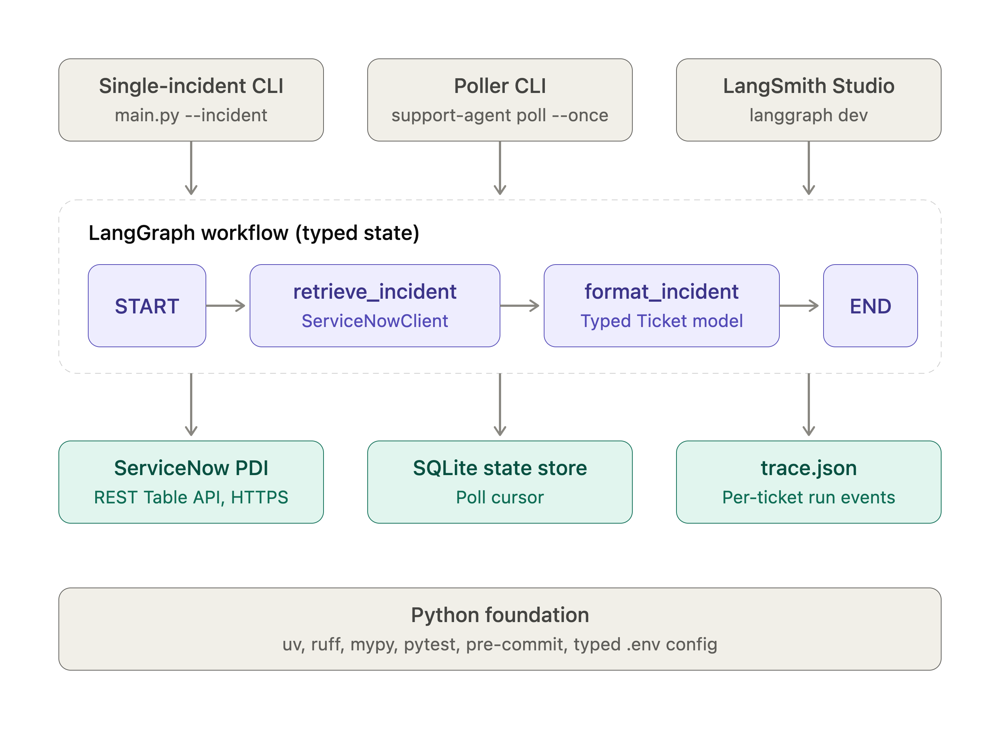

# support-agent

An AI agent that works a ServiceNow incident queue end to end. It triages each ticket, searches the knowledge base, reproduces user-reported bugs in a real browser against the business application (ERPNext), replies to or updates the ticket, and files a Jira issue when it finds a bug. Risky actions wait for human approval.

> **Status:** early development. Done: read-only ServiceNow + LangGraph (Phase 1), LLM triage that writes a preliminary assessment to the incident's internal work notes (Phase 2 Step 1), and retrieval over ERPNext docs, known bugs, and past tickets with hybrid keyword + vector search (Phase 2 Step 2). Track progress in [docs/TASKS.md](docs/TASKS.md).

---

## The scenario

Fictional customer companies (**Brightline Supplies**, **Cobalt Ridge Manufacturing**, **Harborview Foods**) run **ERPNext** for accounting. Their users report problems in **ServiceNow**, engineering tracks defects in **Jira**, and support answers from the **ERPNext documentation** and the list of **known upstream bugs**. The seed tickets are real, closed ERPNext GitHub issues rewritten as end-user reports, all with synthetic callers.

## The problem

L1 support teams spend most of their time on repetitive work: reading a vague ticket, searching the knowledge base, asking the user for missing details, trying to reproduce what the user saw, and copying the steps into Jira for engineering. Every step is simple. Together they are slow, inconsistent, and hard to audit.

`support-agent` automates that loop and keeps humans in control of anything a customer sees or anything that can't be undone.

## What the agent does

```
New incident in ServiceNow
        │
        ▼
 1. Triage ─────────── classify: how-to · missing info · bug · duplicate
        │
        ▼
 2. Research ───────── search KB articles + similar past tickets
        │
        ├── how-to       → draft answer with KB citation        → human approves → reply sent
        ├── missing info → draft clarifying question            → human approves → reply sent
        ├── duplicate    → work note linking the original ticket
        └── bug          → 3. Reproduce in browser (CDP)
                                │  steps + screenshot + console errors
                                ▼
                           4. Create/update Jira issue (auto if confident, else approval)
                                │
                                ▼
                           5. Link Jira to incident, add work note, update state
```

Every step is recorded in a per-ticket trace: tool calls, inputs, results, and screenshots.

## Demo

> 🎬 *Demo video / GIF coming in Phase 8.*

## Architecture at a glance

**Built so far:**

- **Phase 1:** a read-only ServiceNow integration running through a LangGraph workflow.
- **Phase 2:** retrieval, an LLM triage node (Claude, structured output), a deterministic customer rule, and a guarded write node:

  ```
  START → retrieve_incident → format_incident → retrieve_context → analyze_incident
        → apply_customer_policy → write_work_note → END
  ```

  **Retrieval (RAG):** ERPNext docs pages and open ERPNext bugs are ingested from docs.frappe.io and GitHub, and past incidents are synced from ServiceNow. Each chunk is indexed twice in **Postgres**: full text for exact ERP terms and error strings, and a **pgvector** embedding (Voyage AI) for symptoms described in other words. The two rankings are merged with Reciprocal Rank Fusion, a small Claude model reranks the candidates, and anything below the relevance threshold is dropped. The model may cite only what was retrieved, and the note shows each hit's link, score, and which search found it.

  The model estimates impact and urgency, suggests a category, and lists hypotheses, first troubleshooting steps, and missing information. Priority (P1–P5) comes from a configurable impact × urgency matrix, never from the model. A deterministic rule then raises it for **premium customers** (one level, never below P3), based on the incident's company in ServiceNow, never on what the ticket text claims. The result is written as an internal work note titled **AI Triage Assessment (Preliminary)**: dry run by default, and writes only to designated test incidents, at most once per incident, verified in the journal afterwards.



**Target V1 design:**

| Layer | Responsibility |
|---|---|
| **Queue poller** | Pulls new or updated incidents from the ServiceNow Table API (webhooks later) |
| **Agent workflow** | LangGraph state machine. Claude inside nodes: a small model for triage, a stronger model for reasoning and drafting |
| **Typed tools** | `get_ticket`, `search_kb`, `search_similar_tickets`, `reproduce_in_browser`, `add_work_note`, `draft_reply`, `update_state`, `create_jira_issue`, `link_jira` |
| **Guardrails** | Autonomy policy, prompt-injection defenses, browser allow-list, idempotency, kill switch |
| **Review UI** | Local page where a human approves, edits, or rejects pending actions |
| **Retrieval** | ERPNext docs, known bugs, and past incidents in Postgres + pgvector: hybrid keyword + vector search, RRF, LLM rerank, cited answers only |
| **Demo system** | ERPNext (open-source ERP) in Docker, pinned to a version with known bugs |
| **Browser worker** | Chrome over CDP, in an isolated profile, limited to the ERPNext demo URL |
| **Tracing** | Per-ticket JSON trace + screenshots |
| **Evals** | 20–30 golden tickets, scored on routing, KB match, escalation, and safety |

Full details, including the production scale-out design, are in [docs/ARCHITECTURE.md](docs/ARCHITECTURE.md).

## Autonomy policy

| Action | Mode |
|---|---|
| Classify ticket, search KB / similar tickets | ✅ Automatic |
| Reproduce in browser (allow-listed app only) | ✅ Automatic |
| Add internal work note | ✅ Automatic (during development: explicit write mode on designated test incidents only) |
| Reply to customer | 🧑 Human approval |
| Create Jira issue | ⚖️ Automatic above confidence threshold, otherwise approval |
| Close / resolve ticket | 🔒 Human only (agent cannot) |
| **Kill switch** | One flag stops all write actions immediately |

## Security approach

- **Ticket text is untrusted input.** It is passed to the model as clearly delimited data, never as instructions. Tools validate every argument, and the policy layer, not the model, decides what is allowed.
- **Browser is sandboxed.** Separate Chrome profile, a strict URL allow-list (ERPNext demo only), and the agent never navigates to URLs found in tickets.
- **Least privilege.** Dedicated ServiceNow and Jira service accounts with only the roles they need.
- **Secrets only in `.env`.** It is never committed or logged.
- **Synthetic data only.** No real customer data anywhere in the repo.

## Why APIs + CDP

**APIs for systems of record, the browser only for what the user sees.**

ServiceNow and Jira have stable, permissioned, auditable REST APIs. Driving their UIs with a browser would be slower, fragile, and harder to secure. The bug a user reports, though, is about what they saw in the application, so the agent prepares test data through ERPNext's API and then reproduces the steps the way a support engineer would: in a real browser, via the Chrome DevTools Protocol. It captures screenshots, error dialogs, and console and network errors as evidence.

## Quickstart

> Current state: **Phase 2.** The agent retrieves a ServiceNow incident, finds related docs, known bugs, and past tickets, analyzes it with Claude, and proposes (or writes) an internal triage work note. One-command Docker Compose setup for the whole stack comes in Phase 7.

**Prerequisites:** Python 3.11+, Docker, a ServiceNow PDI configured as in [docs/SERVICENOW.md](docs/SERVICENOW.md), a Voyage AI API key, and an Anthropic API key (or, for local development, the Claude CLI signed in to a Claude subscription with `LLM_BACKEND=claude_cli`).

```bash
python3.11 -m venv .venv && source .venv/bin/activate
pip install -e ".[dev]"
cp .env.example .env            # fill in SERVICENOW_*, RETRIEVAL_DB_PASSWORD, RETRIEVAL_DATABASE_URL
python3 scripts/set_secret.py ANTHROPIC_API_KEY   # hidden prompt; same for VOYAGE_API_KEY

# Retrieval index: Postgres + pgvector, then the knowledge and the incidents
docker compose up -d
python3 scripts/ingest_kb.py    # ERPNext docs + open bugs → embeddings
python3 scripts/build_index.py  # incidents (also synced before each run)

# Terminal: dry run (default). Shows the analysis and the proposed work note; writes nothing.
python main.py --incident INC0010001

# Write mode: appends the work note. Only for incidents listed in WRITE_TEST_INCIDENTS.
python main.py --incident INC0010001 --write

# Visual debugging in LangSmith Studio
langgraph dev                   # opens https://smith.langchain.com/studio/?baseUrl=http://127.0.0.1:2024

# Tests (mocked ServiceNow and LLM, no network)
pytest
pytest -m live                  # optional: needs a running `langgraph dev`
pytest -m postgres              # optional: needs `docker compose up -d`
```

Details, validation results, and design notes: [Phase 1](docs/ARCHITECTURE.md#phase-1-servicenow-integration-and-langgraph-setup), [Phase 2 Step 1](docs/ARCHITECTURE.md#phase-2-step-1-llm-triage-and-internal-work-note), and [Phase 2 Step 2](docs/ARCHITECTURE.md#phase-2-step-2-retrieval-rag) build logs.

## Roadmap

- **V1:** polling, KB answers, clarifying questions, CDP bug reproduction, Jira integration, local review UI, eval suite, Docker Compose.
- **Next:** ServiceNow webhooks, job queue + stateless workers, headless browser pool, approvals inside ServiceNow, durable execution, cloud deployment (Cloud Run / ECS → Kubernetes).

## Documentation

- [Architecture](docs/ARCHITECTURE.md)
- [Build plan](docs/TASKS.md)
- [Decision log](docs/DECISIONS.md)
- [ServiceNow setup & reference](docs/SERVICENOW.md)

## License

[MIT](LICENSE) © Julia Vasan
