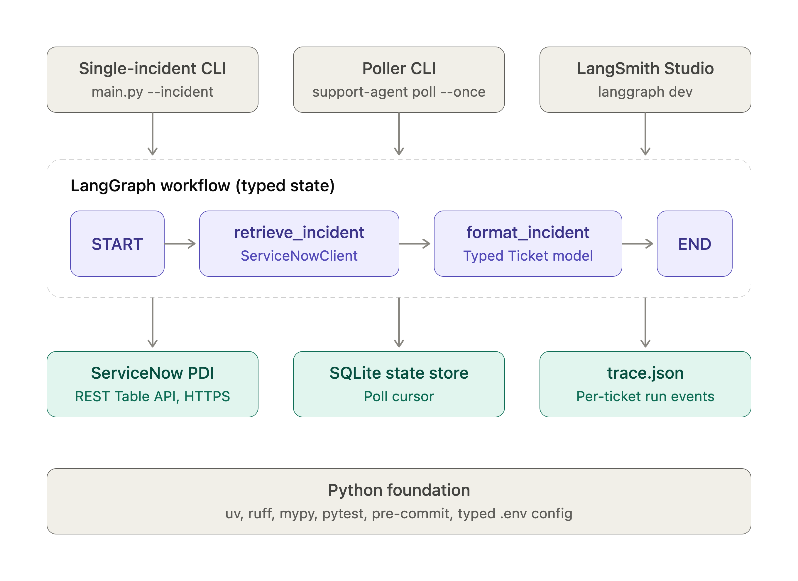

# support-agent

An AI agent that works a ServiceNow incident queue end to end. It triages each ticket, searches the knowledge base, reproduces user-reported bugs in a real browser against the business application (ERPNext), replies to or updates the ticket, and files a Jira issue when it finds a bug. Risky actions wait for human approval.

> **Status:** early development. The foundation, architecture, and build plan are in place. Track progress in [docs/TASKS.md](docs/TASKS.md).

---

## The scenario

A fictional company, **Brightline Supplies**, runs **ERPNext** for accounting. Employees report problems in **ServiceNow**, engineering tracks defects in **Jira**, and support answers from a **knowledge base**. The seed tickets are real, closed ERPNext GitHub issues rewritten as end-user reports, all with synthetic callers.

## The problem

L1 support teams spend most of their time on repetitive work: reading a vague ticket, searching the knowledge base, asking the user for missing details, trying to reproduce what the user saw, and copying the steps into Jira for engineering. Every step is simple. Together they are slow, inconsistent, and hard to audit.

`support-agent` automates that loop and keeps humans in control of anything a customer sees or anything that can't be undone.

## What the agent does

```
New incident in ServiceNow
        │
        ▼
 1. Triage ─────────── classify: how-to · missing info · bug · duplicate
        │
        ▼
 2. Research ───────── search KB articles + similar past tickets
        │
        ├── how-to       → draft answer with KB citation        → human approves → reply sent
        ├── missing info → draft clarifying question            → human approves → reply sent
        ├── duplicate    → work note linking the original ticket
        └── bug          → 3. Reproduce in browser (CDP)
                                │  steps + screenshot + console errors
                                ▼
                           4. Create/update Jira issue (auto if confident, else approval)
                                │
                                ▼
                           5. Link Jira to incident, add work note, update state
```

Every step is recorded in a per-ticket trace: tool calls, inputs, results, and screenshots.

## Demo

> 🎬 *Demo video / GIF coming in Phase 8.*

## Architecture at a glance

**Built so far (Phase 1):** a read-only ServiceNow integration running through a LangGraph workflow.



**Target V1 design:**

| Layer | Responsibility |
|---|---|
| **Queue poller** | Pulls new or updated incidents from the ServiceNow Table API (webhooks later) |
| **Agent workflow** | LangGraph state machine. Claude inside nodes: a small model for triage, a stronger model for reasoning and drafting |
| **Typed tools** | `get_ticket`, `search_kb`, `search_similar_tickets`, `reproduce_in_browser`, `add_work_note`, `draft_reply`, `update_state`, `create_jira_issue`, `link_jira` |
| **Guardrails** | Autonomy policy, prompt-injection defenses, browser allow-list, idempotency, kill switch |
| **Review UI** | Local page where a human approves, edits, or rejects pending actions |
| **Retrieval** | KB articles and past incidents synced from ServiceNow into a local search index (BM25 + LLM rerank), with cited answers only |
| **Demo system** | ERPNext (open-source ERP) in Docker, pinned to a version with known bugs |
| **Browser worker** | Chrome over CDP, in an isolated profile, limited to the ERPNext demo URL |
| **Tracing** | Per-ticket JSON trace + screenshots |
| **Evals** | 20–30 golden tickets, scored on routing, KB match, escalation, and safety |

Full details, including the production scale-out design, are in [docs/ARCHITECTURE.md](docs/ARCHITECTURE.md).

## Autonomy policy

| Action | Mode |
|---|---|
| Classify ticket, search KB / similar tickets | ✅ Automatic |
| Reproduce in browser (allow-listed app only) | ✅ Automatic |
| Add internal work note | ✅ Automatic |
| Reply to customer | 🧑 Human approval |
| Create Jira issue | ⚖️ Automatic above confidence threshold, otherwise approval |
| Close / resolve ticket | 🔒 Human only (agent cannot) |
| **Kill switch** | One flag stops all write actions immediately |

## Security approach

- **Ticket text is untrusted input.** It is passed to the model as clearly delimited data, never as instructions. Tools validate every argument, and the policy layer, not the model, decides what is allowed.
- **Browser is sandboxed.** Separate Chrome profile, a strict URL allow-list (ERPNext demo only), and the agent never navigates to URLs found in tickets.
- **Least privilege.** Dedicated ServiceNow and Jira service accounts with only the roles they need.
- **Secrets only in `.env`.** It is never committed or logged.
- **Synthetic data only.** No real customer data anywhere in the repo.

## Why APIs + CDP

**APIs for systems of record, the browser only for what the user sees.**

ServiceNow and Jira have stable, permissioned, auditable REST APIs. Driving their UIs with a browser would be slower, fragile, and harder to secure. The bug a user reports, though, is about what they saw in the application, so the agent prepares test data through ERPNext's API and then reproduces the steps the way a support engineer would: in a real browser, via the Chrome DevTools Protocol. It captures screenshots, error dialogs, and console and network errors as evidence.

## Quickstart

> Current state: **Phase 1** (read-only). The agent retrieves a ServiceNow incident through a LangGraph workflow. One-command Docker Compose setup comes in Phase 7.

**Prerequisites:** Python 3.11+, a ServiceNow PDI configured as in [docs/SERVICENOW.md](docs/SERVICENOW.md).

```bash
python3.11 -m venv .venv && source .venv/bin/activate
pip install -e ".[dev]"
cp .env.example .env            # fill in SERVICENOW_* values

# Terminal
python main.py --incident INC0010001

# Visual debugging in LangSmith Studio
langgraph dev                   # opens https://smith.langchain.com/studio/?baseUrl=http://127.0.0.1:2024

# Tests (mocked ServiceNow, no network)
pytest
pytest -m live                  # optional: needs a running `langgraph dev`
```

Details, validation results, and design notes: [Phase 1 build log](docs/ARCHITECTURE.md#phase-1-servicenow-integration-and-langgraph-setup).

## Roadmap

- **V1:** polling, KB answers, clarifying questions, CDP bug reproduction, Jira integration, local review UI, eval suite, Docker Compose.
- **Next:** ServiceNow webhooks, job queue + stateless workers, headless browser pool, approvals inside ServiceNow, durable execution, cloud deployment (Cloud Run / ECS → Kubernetes).

## Documentation

- [Architecture](docs/ARCHITECTURE.md)
- [Build plan](docs/TASKS.md)
- [Decision log](docs/DECISIONS.md)
- [ServiceNow setup & reference](docs/SERVICENOW.md)

## License

[MIT](LICENSE) © Julia Vasan
