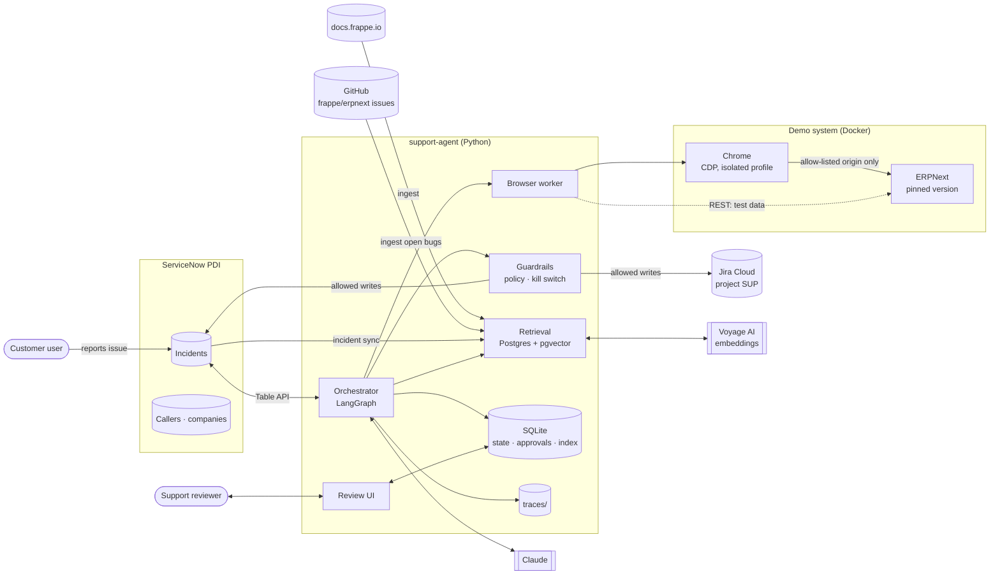
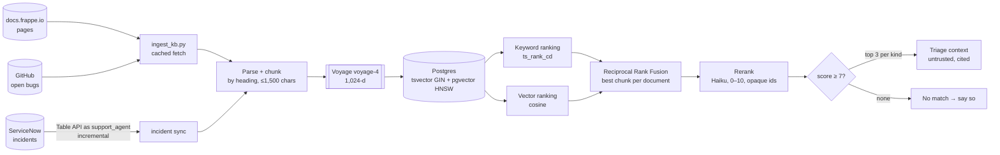
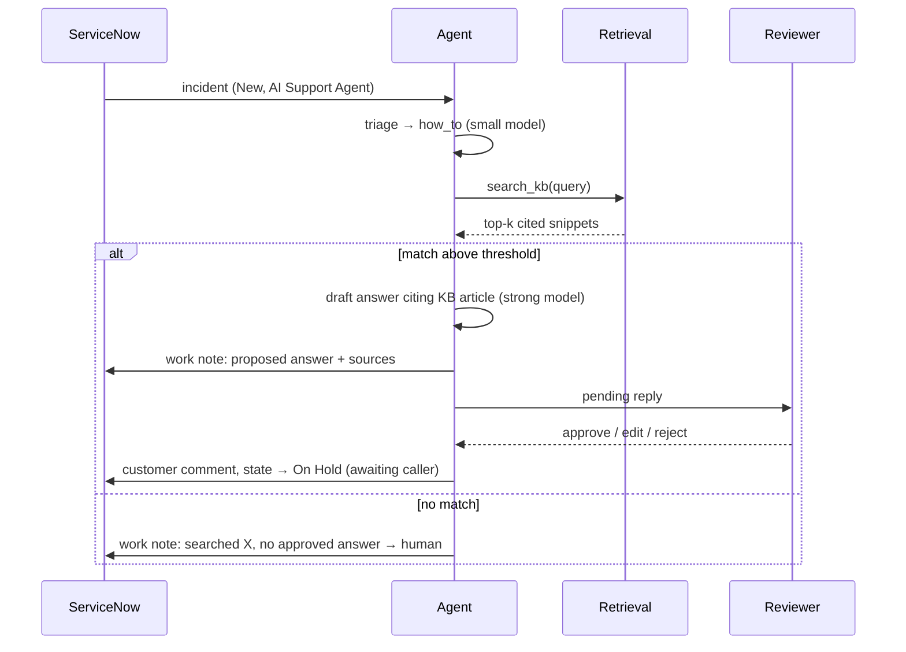
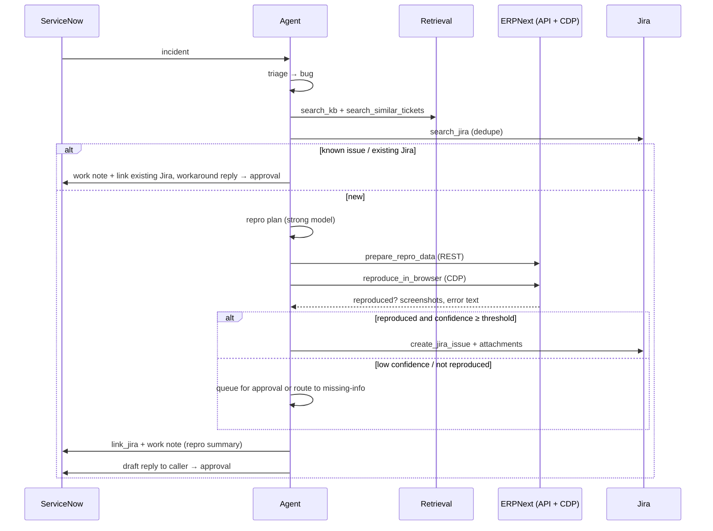
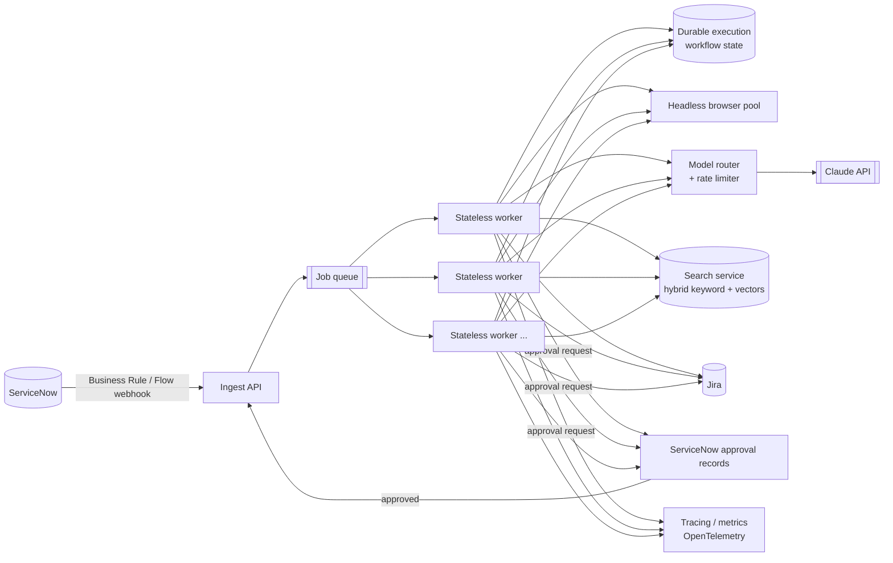
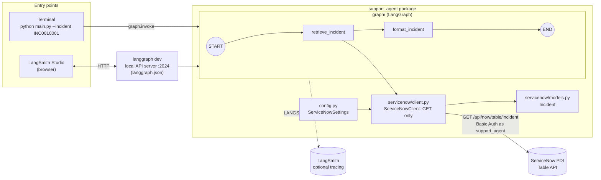
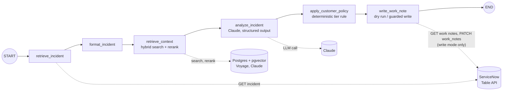

# Architecture

This document describes the V1 architecture of `support-agent`: the systems it connects, how it retrieves knowledge, how it reproduces bugs, the policies that constrain it, and how it evolves into a production deployment.

> **Status legend:** ✅ built · 🚧 in progress · 📋 planned
>
> **Build log:** what has been implemented and how it was validated is recorded per phase at the end of this document: [Phase 1](#phase-1-servicenow-integration-and-langgraph-setup), [Phase 2 Step 1](#phase-2-step-1-llm-triage-and-internal-work-note), [Phase 2 Step 2 (retrieval)](#phase-2-step-2-retrieval-rag).

## 1. The scenario

Fictional customer companies (**Brightline Supplies**, **Cobalt Ridge Manufacturing**, **Harborview Foods**) run **ERPNext** (open-source ERP) for accounting. Their users report problems to support through **ServiceNow**. Engineering tracks real defects in **Jira**. Support answers from the **ERPNext documentation** and tracks **known upstream bugs**.

`support-agent` plays the role of an L1/L2 support engineer on that queue:

| System | Role in the scenario | Agent access |
|---|---|---|
| **ServiceNow** (PDI) | System of record for incidents, callers, and customer companies | Table API, as `support_agent` |
| **ERPNext** (Docker) | The business application users report problems about. The **demo system** where bugs are reproduced | Browser via CDP (UI) + REST API (test-data setup) |
| **Jira Cloud** | Engineering backlog for confirmed defects | REST API |
| **Knowledge** | ERPNext docs pages (docs.frappe.io) and open ERPNext bugs (GitHub) | Ingested from the source → Postgres + pgvector |
| **Voyage AI** | Embeddings for vector search | REST API |
| **Claude** | Reranking and triage (small model); reasoning/drafting later (strong model) | Messages API, or the Claude CLI on a subscription for local development (ADR-014) |

Seed tickets are closed ERPNext GitHub issues (label `accounts`), rewritten as end-user reports from fictional callers. See [SERVICENOW.md](SERVICENOW.md).

## 2. Design principles

1. **APIs for systems of record, CDP only for what the user sees.** ServiceNow and Jira are accessed only through their REST APIs. ERPNext test data is prepared through its REST API. The browser is used only to reproduce what the user saw in ERPNext's UI.
2. **The model proposes, the policy decides.** The LLM chooses tools and drafts content. A deterministic policy layer decides whether an action runs, waits for approval, or is refused.
3. **Narrow, typed tools.** Each tool does one thing, validates input with a schema, and returns structured output. No generic HTTP, SQL, or shell tools.
4. **Untrusted input stays data.** Ticket text, KB content, Jira content, and web page content are never treated as instructions.
5. **Grounded answers or no answer.** Customer-facing answers must cite a KB article. With no good match, the agent escalates instead of improvising.
6. **Separate identities per purpose.** The agent, the data seeder, and the human admin use different accounts in every system.
7. **Everything is traceable and idempotent.** Every run produces a trace. Every write is keyed so retries never double-reply or duplicate a Jira issue.
8. **Simple first, scalable later.** V1 is a single Python process plus containers. Component boundaries are drawn so each piece can become a service.

## 3. System context



## 4. Components

| Component | Location | Responsibility | Status |
|---|---|---|---|
| **ServiceNow setup** | `scripts/servicenow_setup.py` | Idempotent provisioning of groups, service accounts, and scoped KB | ✅ |
| **Seeder** | `scripts/seed_incidents.py`, `data/seed/` | Loads synthetic callers and incidents as `seed_loader` | ✅ |
| **Queue poller** | `src/support_agent/` | Polls incidents assigned to *AI Support Agent* that changed since the last cursor | 📋 |
| **Orchestrator** | `src/support_agent/graph/` | **LangGraph** `StateGraph`: triage → research → plan → act → disposition. Enforces step, token, and time budgets. Phase 1: read-only retrieve → format graph | 🚧 |
| **Model router** | `src/support_agent/graph/` | Small model for triage/classification. Strong model for reasoning, drafting, repro planning | 📋 |
| **LLM backends** | `src/support_agent/llm.py` | Structured-output calls via the Anthropic API or the Claude CLI (ADR-014) | ✅ |
| **Retrieval** | `src/support_agent/retrieval/`, `docker-compose.yml` | Ingests docs pages and open bugs, syncs incidents, hybrid search (Postgres full text + pgvector, RRF), LLM rerank, threshold (§5) | ✅ |
| **Typed tools** | `src/support_agent/tools/` | One module per tool, with Pydantic input/output schemas | 📋 |
| **ServiceNow client** | `src/support_agent/servicenow/` | Reads incidents, work notes, and incident listings for the index. One write: `add_work_note` | 🚧 |
| **Jira client** | `src/support_agent/tools/` | Search (JQL), create, comment, attach | 📋 |
| **ERPNext client** | `src/support_agent/tools/` | REST API for creating repro test data (fixtures) only | 📋 |
| **Browser worker** | `src/support_agent/tools/` | Drives Chrome over CDP against ERPNext: login, navigate, click, type, screenshot, collect errors | 📋 |
| **Guardrails** | `src/support_agent/guardrails/` | Autonomy policy, injection screening, argument validation, URL allow-list, idempotency, kill switch | 📋 |
| **Review UI** | `src/support_agent/review_ui/` | Local page to approve, edit, or reject pending actions | 📋 |
| **State store** | SQLite (Postgres later) | Poll cursor, runs, approvals, idempotency keys | 📋 |
| **Trace writer** | `src/support_agent/graph/` | `traces/<ticket>/<run_id>/trace.json` + screenshots. Optional LangSmith tracing is already available | 📋 |
| **Demo system** | `demo_app/` | Docker Compose for a pinned ERPNext + fixtures for the fictional company | 📋 |
| **Evals** | `evals/` | Golden tickets, runner, scoring | 📋 |

### Tool catalogue

| Tool | System | Side effect | Default policy |
|---|---|---|---|
| `get_ticket(number)` | ServiceNow | read | auto |
| `search_kb(query, k)` | retrieval index (ERPNext docs, known bugs) | read | auto |
| `search_similar_tickets(query, k)` | retrieval index (ServiceNow incidents) | read | auto |
| `search_jira(query)` | Jira | read | auto |
| `prepare_repro_data(scenario)` | ERPNext REST | demo-system write (isolated) | auto |
| `reproduce_in_browser(steps, expected)` | ERPNext UI via CDP | browser (sandboxed) | auto |
| `add_work_note(ticket, text)` | ServiceNow | internal write | auto |
| `draft_reply(ticket, text, citations)` | ServiceNow | pending reply | approval before send |
| `update_state(ticket, state)` | ServiceNow | write | auto for `In Progress` / `On Hold`. Resolve and close are **refused** |
| `create_jira_issue(summary, steps, evidence)` | Jira | external write | auto if confidence ≥ threshold, else approval |
| `link_jira(ticket, issue_key)` | ServiceNow + Jira | write | auto |

## 5. Retrieval

✅ Built in Phase 2 Step 2 (ADR-013). Today it runs as the `retrieve_context` graph node; the `search_kb` / `search_similar_tickets` tools of the agent loop will call the same service.

Retrieval answers three questions, each from its own source:

| Question | Source | Kind | Used for |
|---|---|---|---|
| *"Is there documented behavior or a how-to?"* | ERPNext docs pages (docs.frappe.io), ingested | `kb_article` | Grounding causes and steps in how ERPNext works; how-to answers with citation |
| *"Is this a known, unfixed defect?"* | Open ERPNext bugs (GitHub search), ingested | `known_issue` | Flagging a possible match to an upstream bug, with its link |
| *"Have we seen this before?"* | ServiceNow incidents, synced as `support_agent` | `incident` | Duplicates and past resolutions, as hints |
| *"Is engineering already tracking it?"* | Jira project | (live search) | Jira dedupe before creating an issue (📋) |

### 5.1 Indexing and search pipeline



- **Two signals in one database.** Each chunk has a weighted `tsvector` (title > heading > body) and a Voyage embedding. Keyword search is strong on ERP terms and exact error strings; vector search on paraphrase. RRF (k = 60) merges the rankings without calibrating their scores.
- **Ingestion from the source.** `scripts/ingest_kb.py` fetches the pages in `data/seed/kb_sources.json` and open bugs from a GitHub search, caches them in `data/kb_cache/` (gitignored, never committed), and embeds only new or changed documents. Bugs that close drop out on the next run.
- **Incident sync as the agent.** Incidents sync incrementally by `sys_updated_on` as `support_agent`, so ServiceNow ACLs decide what is searchable. The incident being triaged is excluded from its own results.
- **Rerank and threshold.** Up to 8 candidates per kind go to the small model under opaque ids (C1, C2, …), so a score can only attach to a retrieved candidate. Hits scoring below `KB_RELEVANCE_THRESHOLD` (default 7) are dropped; at most 3 per kind are kept.
- **Graceful degradation.** Embedding failure → keyword-only, with a warning. Sync failure → existing index. Database down → triage runs without retrieval and the note says "Not available". Without `RETRIEVAL_DATABASE_URL`, a keyword-only SQLite FTS5 index is used (offline and tests).

### 5.2 Using retrieved content

- Hits enter the prompt inside an escaped `<retrieved_documents>` block of `<document id=... type=...>` entries, labeled as data, not instructions.
- The model may cite only ids from that block. `relevant_documents` and `possible_match_id` are checked in code; anything not retrieved is dropped and reported (`dropped_references`).
- The work note lists the hits under "Related knowledge" with relevance, link, which retriever found them, and whether the analysis used them. Known issues show their upstream reference.
- Resolved incidents are **hints, not sources**: they can point to the right page or workaround but are never quoted to a customer.
- No match above the threshold → the note says so, and nothing is improvised.

### 5.3 Knowledge content

- **Docs:** 32 ERPNext documentation pages on the accounting topics of the seed tickets (payments, invoices and returns, multi-currency, cost centers, period closing, bank reconciliation, settings).
- **Known issues:** the 40 most recent open issues from `repo:frappe/erpnext is:issue state:open label:accounts label:bug`.
- Both are public. They are fetched at ingest time with attribution (source URL on every hit), not copied into the repository.

## 6. Bug reproduction in ERPNext

### 6.1 Demo system

- **ERPNext in Docker** (official `frappe_docker` images), **pinned to a version that predates the fixes** for the seeded bugs. The seed tickets are closed upstream issues, so a current release won't reproduce them.
- **Fixtures via REST API** (`prepare_repro_data`): the fictional company "Brightline Supplies", currencies (INR, USD, KWD), suppliers, accounts, item tax templates. Fixtures are created as a dedicated ERPNext API user, never Administrator.
- **Isolation:** each repro run creates uniquely named records (prefix `REPRO-<run_id>`). A database snapshot can be restored to reset the site between demo sessions.

### 6.2 Reproduction flow

1. The strong model turns the ticket into a **structured repro plan**: preconditions (data needed), UI steps, expected result, and failure signal (error text, wrong status value).
2. `prepare_repro_data` creates the preconditions through the ERPNext API.
3. `reproduce_in_browser` logs in as the repro user and executes the UI steps over CDP. It captures:
   - screenshots at each step and at failure
   - ERPNext error dialogs (DOM text), console errors, and failed network responses (Frappe returns validation errors as `417` with a message)
4. The result is `reproduced` / `not_reproduced` / `blocked`, with observations and evidence paths, all written to the trace.

### 6.3 Browser guardrails

- Chrome runs in its own container with a **dedicated profile** and no saved credentials except the repro user's session.
- A CDP request interceptor **blocks every origin except the ERPNext demo URL**.
- The agent **never navigates to URLs from tickets.** It always starts from the configured ERPNext base URL.
- The repro user has a limited ERPNext role (e.g. *Accounts User*), not System Manager.

## 7. Jira integration

| Aspect | Design |
|---|---|
| Project | `SUP`, issue type Bug |
| Content | Summary, steps to reproduce, expected vs actual, environment (ERPNext version), evidence (screenshots attached), link to the ServiceNow incident |
| Labels | `support-agent`, `snow-INC00100xx`, ERPNext module (e.g. `accounts`) |
| Dedupe | Before creating: JQL search by label `snow-<incident>`, then by summary similarity among open issues. A match means comment and link instead of creating a new issue |
| Back-link | Jira key and URL stored on the incident (work note now, plus a dedicated `u_jira_issue` field, 📋) and in the agent's state DB |
| Idempotency | Key `(incident, "create_jira")` stored before the API call, checked on retry |
| Autonomy | Auto-create only when **reproduced** and confidence ≥ `JIRA_AUTO_CONFIDENCE`. Otherwise it goes to the review UI |

## 8. Data flow by ticket type

### 8.1 How-to → KB answer (e.g. INC0010009, INC0010010)



### 8.2 Missing info → ask the caller (e.g. INC0010003)

1. Triage flags missing essentials: which document or screen, steps, ERPNext version, the exact error.
2. The agent drafts **one** concise question listing exactly what it needs.
3. The reply goes to approval. Once sent, state is set to *On Hold – Awaiting Caller*.
4. When the caller responds, the incident changes, gets re-polled, and is triaged again.

### 8.3 Bug → reproduce → Jira (e.g. INC0010005, INC0010006)



### 8.4 Duplicate

If `search_similar_tickets` finds an open incident above the similarity threshold, or `search_jira` finds a matching open issue, the agent adds a work note linking the original, links the existing Jira issue, and creates nothing new.

## 9. Identities and access

| System | Account | Used by | Access | Credentials |
|---|---|---|---|---|
| ServiceNow | `admin` | Human, setup script | Full. API exception role only during setup | `.env.admin` |
| ServiceNow | `support_agent` | Agent | API only (WSAO). `itil` via group *AI Support Agent*. Reads incidents; writes internal work notes only | `.env` |
| ServiceNow | `seed_loader` | Seeder scripts | API only (WSAO). `itil` + `user_admin` via group *Seed Data Loaders* | `.env` |
| ServiceNow | callers | Seed data | No roles, no login | none |
| ERPNext | Administrator | Human only | Full | password manager |
| ERPNext | `repro_bot` 📋 | Browser worker | UI login, limited role (Accounts User) | `.env` |
| ERPNext | `erp_fixtures` 📋 | `prepare_repro_data` | API key/secret, scoped to fixture doctypes | `.env` |
| Jira | agent account 📋 | Agent | API token, project `SUP` only | `.env` |
| Anthropic | API key | Agent (`LLM_BACKEND=api`) | Spend-limited key | `.env` |
| Claude subscription | CLI login | Agent (`LLM_BACKEND=claude_cli`, local development) | `claude -p` with no tools (ADR-014) | Claude CLI's own login |
| Voyage AI | API key | Retrieval (embeddings) | Embeddings only | `.env` → `VOYAGE_API_KEY` |
| Postgres (local) | `support_agent` | Retrieval index | Its own database, bound to 127.0.0.1 | `.env` → `RETRIEVAL_DB_PASSWORD` |

All secrets live only in gitignored `.env` files and are redacted from traces.

## 10. Autonomy and guardrail policy

The policy is declarative (`src/support_agent/guardrails/`) and evaluated **outside** the model:

| Action | Mode | Notes |
|---|---|---|
| Classify, search, read | auto | |
| Prepare repro data in ERPNext | auto | Demo system only, uniquely named records |
| Reproduce in browser | auto | ERPNext origin only |
| Work note | auto | Internal only |
| Customer reply | approval | Must cite retrieved KB. Reviewer can edit |
| Jira create | conditional | Auto if reproduced and confidence ≥ `JIRA_AUTO_CONFIDENCE`, else approval |
| Resolve / close | **forbidden** | Humans only |
| Any write while kill switch is on | **forbidden** | Read and draft only |

**Kill switch:** `AGENT_KILL_SWITCH=true` (env) or a runtime flag file, checked before every write.
**Budgets:** max steps, tokens, and wall-clock time per run. Hitting a limit ends the run with a work note and hands the ticket to a human.

## 11. Security model

| Threat | Mitigation |
|---|---|
| **Prompt injection in ticket text** | Delimited untrusted-data blocks. Deterministic policy outside the model. Heuristic injection screen flags tickets for review. No destructive tools exist |
| **Injection via docs, bug reports, Jira, or page content** | Treated the same as ticket text: escaped, delimited, never instructions. The reranker sees opaque ids, and citations outside the retrieved set are dropped |
| **Malicious URLs in tickets** | Browser starts only from the configured ERPNext URL. Interceptor blocks all other origins |
| **Browser compromise or data leakage** | Separate container and profile, demo system only, synthetic data only |
| **Over-privileged credentials** | Separate least-privilege accounts per purpose (§9). No admin use at runtime |
| **Secret leakage** | Secrets only in `.env` (gitignored). Traces redact auth headers and tokens |
| **Duplicate or replayed actions** | Idempotency key per `(ticket, action, content hash)`. Jira dedupe search |
| **Runaway agent** | Budgets, rate limits, kill switch |
| **Ungrounded answers** | Citation required and validated against the retrieved set. No-match → escalate |

## 12. Observability

- **Per-ticket trace:** `traces/<ticket>/<run_id>/trace.json` holds an ordered list of events: model calls (model, tokens, latency, cost), retrieval queries and results (ids, scores), tool calls (input, output, policy decision), approvals, errors. Screenshots are stored alongside.
- **Run summary:** one line per run with disposition, duration, cost, and actions taken.
- **ServiceNow-visible audit:** every agent action leaves a work note, so humans see the agent's reasoning in the ticket's activity stream.

## 13. Evaluation

- **Golden set:** the 10 seed incidents plus 10–20 more (duplicates, prompt-injection attempts, non-reproducible bugs), each labeled in `data/seed/` or `evals/golden/` with expected type, KB article, escalation, and forbidden actions.
- **Metrics:** routing accuracy · KB retrieval hit@k · citation validity · correct escalation (Jira exactly when expected) · repro success rate · **unsafe actions = 0** (hard gate).
- **Execution:** offline by default against mocked ServiceNow/Jira/ERPNext clients (deterministic, free). Optional live mode against the PDI and demo ERPNext.
- **CI:** safety gate + fast subset on every PR.

## 14. Production architecture

V1 runs as one process to stay demoable. Production keeps the same tools and policy but changes the runtime around them.



| Concern | V1 | Production |
|---|---|---|
| **Ingest** | Polling the Table API | Business Rule / Flow Designer → webhook → ingest API. Polling kept as a reconciliation fallback |
| **Work distribution** | In-process loop | Job queue (SQS / Pub/Sub / Redis Streams). One message per ticket change, deduped by `sys_id + sys_mod_count` |
| **Workers** | Single process | Stateless workers that scale horizontally |
| **Long waits (approvals)** | SQLite pending table | Durable execution (e.g. Temporal): a run pauses for hours and resumes exactly once |
| **Retrieval** | Postgres full text + pgvector in Docker, RRF, LLM rerank; ingestion run by hand | Managed Postgres (or a search service) with the same hybrid query, scheduled or event-driven ingestion, per-tenant indexes, private KBs synced as the agent identity |
| **Browser** | One local Chrome | Headless browser pool, one context per job, network-isolated to allow-listed apps |
| **Demo/target app** | Pinned ERPNext in Docker | Customer's staging environment, never production, through a dedicated repro tenant |
| **Models** | Fixed models from config; API or Claude CLI backend | API only. Routing by step and difficulty, fallback model, prompt caching, per-tenant budgets |
| **Rate limits and retries** | Basic backoff | Token buckets per API, backoff with jitter, circuit breakers, dead-letter queue |
| **Approvals** | Local review UI | Native ServiceNow approvals or UI actions, where reviewers already work |
| **Auth** | Basic Auth (WSAO accounts) | OAuth 2.0 client credentials, short-lived tokens, secret manager |
| **Observability** | JSON traces | OpenTelemetry, dashboards (deflection rate, approval rate, cost per ticket), alerting |

### Deployment path

1. **Docker Compose:** agent, review UI, browser, ERPNext, all with one command.
2. **Cloud Run / ECS Fargate:** same containers, managed queue and Postgres.
3. **Kubernetes:** autoscaling browser pools, multi-tenant isolation, network policies.

## 15. Trade-offs

| Decision | Benefit | Cost |
|---|---|---|
| ERPNext as demo system (vs custom demo app) | Real, complex enterprise app with real bugs, which is credible for hiring audiences | Heavier to run (several containers). Version pinning needed for closed bugs |
| Seed tickets from real closed issues | Realistic language and bugs with known ground truth | Must run a pre-fix ERPNext version. Some bugs need specific data or currency setups |
| Polling over webhooks in V1 | Works on a PDI without inbound networking | Latency and extra API calls |
| Hybrid keyword + vector search in one Postgres (ADR-013) | Exact ERP terms *and* paraphrased symptoms; one database, SQL-inspectable; standard production stack | One more service and an embeddings vendor. Hybrid's benefit still to be measured by a retrieval eval |
| Knowledge ingested from its sources, not via ServiceNow KB | No draft/publish workflow to fight; content stays current with the source | Not access-controlled by ServiceNow. Fine for public docs and bugs; a private KB would be synced as the agent |
| Incidents synced as the agent identity | ACLs inherited automatically | Index must be rebuilt if agent permissions change |
| Claude CLI backend for development (ADR-014) | Runs on a subscription when API credit is out | Slower (~10 s per call), subscription limits, API-only features skipped |
| Single process + SQLite | Trivial to run and reason about | No horizontal scale. Boundaries kept clean for migration |
| Local review UI over ServiceNow approvals | Fast to build, no PDI customization | Reviewers leave their usual tool |
| Raw CDP over a high-level framework | Explicit control over interception and evidence capture | More code than Playwright |
| Narrow tools | Auditable, easy to guard and test | New capability = new tool, by design |
| Confidence-gated Jira auto-create | Less reviewer load for clear bugs | Needs calibration through evals |

## 16. Open questions

| # | Question | Proposed default |
|---|---|---|
| 1 | Which ERPNext version to pin? The seed bugs span v15 and v16 fixes | Pick the version that reproduces the most seed bugs. Mark the others `not_reproducible_in_demo` (still a valid eval path) |
| 2 | ~~Rename KB "Customer Portal Support"?~~ | Moot: the agent no longer reads a ServiceNow KB (ADR-013). The KB stays only for the setup access check |
| 3 | Store the Jira key on the incident in a custom field? | Add `u_jira_issue` via setup script (admin). Work note in the meantime |
| 4 | ~~Embeddings provider~~ | Voyage AI `voyage-4` (ADR-013). The retrieval eval (§13) should still compare keyword, vector, and hybrid |

---

# Build log

## Phase 1: ServiceNow Integration and LangGraph Setup

**Status: ✅ complete (2026-10-27).** Read-only. No LLM calls, no writes to ServiceNow.

> Numbering note: this is the first *implementation* phase. It covers the "Read the queue" groundwork in [TASKS.md](TASKS.md) Phase 1, scoped to retrieving a single incident through a LangGraph workflow.

### P1.1 Goal

Prove the end-to-end skeleton the agent will grow on: typed configuration → a read-only ServiceNow client → a LangGraph workflow → a terminal command and a visual debugger (LangSmith Studio) → automated tests.

### P1.2 What was built

| Component | Location | Status |
|---|---|---|
| Configuration (typed, env-based, password hidden from `repr`) | `src/support_agent/config.py` | ✅ |
| ServiceNow client (read-only, typed errors) | `src/support_agent/servicenow/client.py` | ✅ |
| Incident model (Pydantic) | `src/support_agent/servicenow/models.py` | ✅ |
| Graph state (typed input / output / internal) | `src/support_agent/graph/state.py` | ✅ |
| Graph nodes | `src/support_agent/graph/nodes.py` | ✅ |
| Graph definition + Studio entry point | `src/support_agent/graph/workflow.py` | ✅ |
| Terminal interface | `src/support_agent/cli.py`, `main.py` | ✅ |
| LangGraph dev server / Studio config | `langgraph.json` | ✅ |
| Optional LangSmith tracing | `.env` (`LANGSMITH_*`) | ✅ (off by default) |
| Tests (mocked ServiceNow) | `tests/` | ✅ 30 offline + 1 live |
| RAG, LLM analysis, polling, webhooks, Jira, ERPNext | n/a | 📋 later phases |

### P1.3 Architecture



**Separation of concerns:**

| Layer | Knows about | Doesn't know about |
|---|---|---|
| `config` | Environment variables | ServiceNow, LangGraph |
| `servicenow` | Table API, HTTP, auth | LangGraph, terminal |
| `graph` | State, nodes, flow | HTTP details (client injected through a factory) |
| `cli` | Arguments, output | ServiceNow, HTTP |

The client is **injected** into the graph (`build_graph(client_factory=...)`), so tests run the real graph with a mocked client, and later phases can swap in other clients (Jira, ERPNext) the same way.

### P1.4 Tools and versions

| Tool | Version | Purpose |
|---|---|---|
| Python | 3.11.4 (`.venv`) | Runtime |
| LangGraph | 1.2.18 | Workflow / state machine |
| LangGraph CLI (`[inmem]`) | 0.4.40 | `langgraph dev` local server for Studio |
| langgraph-api | 0.16.7 | Dev server runtime (installed by the CLI) |
| LangSmith SDK | 0.14.13 | Optional tracing, Studio |
| Pydantic | 2.14.1 | Incident model, schemas |
| requests | 2.34.2 | ServiceNow HTTP (reuses the existing working connection) |
| python-dotenv | 1.2.4 | Load `.env` |
| pytest | 9.1.1 | Tests |

Dependencies are declared in `pyproject.toml` (runtime + `[dev]` extra). `langgraph.json` uses `"dependencies": ["."]`, so the dev server installs the same package.

### P1.5 Install

```bash
python3.11 -m venv .venv
source .venv/bin/activate
pip install -e ".[dev]"
cp .env.example .env        # then fill in SERVICENOW_* (see docs/SERVICENOW.md)
```

The ServiceNow connection reuses the existing `support_agent` service account and `.env` variables (`SERVICENOW_INSTANCE_URL`, `SERVICENOW_USERNAME`, `SERVICENOW_PASSWORD`). No new authentication was created.

### P1.6 LangGraph workflow

```
START → retrieve_incident → format_incident → END
```

| Node | Reads | Writes | Behavior |
|---|---|---|---|
| `retrieve_incident` | `incident_id` | `incident`, `error`, `error_type` | Calls `ServiceNowClient.get_incident`. Every `ServiceNowError` is caught and written to state, so the graph never crashes on API errors |
| `format_incident` | `incident`, `error` | `display` | Renders a text card (or `ERROR (<type>): <message>`) for the terminal and Studio |

**State schemas** (`graph/state.py`):
- `InputState`: `incident_id` only. This is what Studio shows as the input form.
- `OutputState`: `incident`, `error`, `display`. This is what callers get back.
- `IncidentState`: internal, adds `error_type`.

The workflow is deliberately linear. Later phases add nodes and conditional edges (triage → route by ticket type) without changing the entry points.

### P1.7 ServiceNow API integration

| Aspect | Implementation |
|---|---|
| Endpoint | `GET /api/now/table/incident` |
| By number | `sysparm_query=number=INC0010001`, `sysparm_limit=1` |
| By sys_id | `GET /api/now/table/incident/<sys_id>` |
| Fields | `sys_id, number, short_description, description, priority, state, category, assignment_group, assigned_to, caller_id, opened_at` |
| Display values | `sysparm_display_value=true`, `sysparm_exclude_reference_link=true` (names instead of sys_ids for group, assignee, caller) |
| Auth | Basic Auth as `support_agent` (WSAO account, see [SERVICENOW.md](SERVICENOW.md) §5) |
| Timeout | 30 s (`SERVICENOW_TIMEOUT_SECONDS`) |
| Input validation | Identifier must match `INC\d{7,}` or a 32-hex sys_id. Anything else is rejected **before** any request, which also blocks encoded-query injection such as `INC001^ORactive=true` |
| Errors | `InvalidIdentifierError`, `IncidentNotFoundError` (empty result / 404), `ServiceNowAuthError` (401), `ServiceNowPermissionError` (403), `ServiceNowError` (other HTTP, network, non-JSON). Messages contain only ServiceNow's error text |
| Read-only | The client's only public method is `get_incident`, and it only issues GET. A test enforces both |

### P1.8 Terminal commands

```bash
python main.py --incident INC0010001                          # by number
python main.py --incident 7b17848cc3d05310783ef9477d013199    # by sys_id
python main.py --incident INC0010001 --json                   # final graph state as JSON
```

Exit codes: `0` success, `1` error (not found, invalid id, auth, API). `main.py` adds `src/` to the path, so it also runs without `pip install -e .`.

**Validated output (live, 2026-10-27):**

```
$ python main.py --incident INC0010001
Number            : INC0010001
Short description : Some ERPNext screens stay in English after switching my language to Arabic
Priority          : 4 - Low
State             : New
Category          : Software
Assignment group  : AI Support Agent
Assigned to       : -
Caller            : Amira Haddad
Opened            : 2026-10-27 13:10:15
sys_id            : 7b17848cc3d05310783ef9477d013199

Description:
  Hi,
  I changed my ERPNext language to Arabic. ...

$ python main.py --incident INC9999999
ERROR (IncidentNotFoundError): Incident INC9999999 not found

$ python main.py --incident "INC001^ORactive=true"
ERROR (InvalidIdentifierError): 'INC001^ORactive=true' is not an incident number (e.g. INC0010001) or a 32-character sys_id
```

### P1.9 LangSmith Studio

**`langgraph.json`:**

```json
{
  "python_version": "3.11",
  "dependencies": ["."],
  "graphs": { "incident_workflow": "./src/support_agent/graph/workflow.py:graph" },
  "env": ".env"
}
```

**Run:**

```bash
source .venv/bin/activate
langgraph dev            # API on http://127.0.0.1:2024, opens Studio
```

Studio URL: `https://smith.langchain.com/studio/?baseUrl=http://127.0.0.1:2024`

1. Sign in to LangSmith (free account) when prompted.
2. Select the **incident_workflow** graph. It shows `__start__ → retrieve_incident → format_incident → __end__`.
3. Enter `{"incident_id": "INC0010001"}` in the input form and click **Submit**.
4. Click each node to inspect its state update (`incident`, `error`, `display`).

**Optional tracing.** Set `LANGSMITH_TRACING=true` and `LANGSMITH_API_KEY` in `.env` to send runs to the LangSmith project `support-agent`. It's off by default, because traces include incident content. That's fine for synthetic data, but it's a data-sharing decision.

**Browser note.** Safari blocks an HTTPS page from calling `http://127.0.0.1`. Use Chrome or Firefox, or run `langgraph dev --tunnel`.

**Validated (2026-10-27):** dev server started, `GET /ok` → 200, graph `incident_workflow` registered (`POST /assistants/search`), and `POST /runs/wait` with `{"incident_id": "INC0010005"}` returned the real incident. That's the same API Studio uses. No blocking-I/O warnings were raised.

**Validated in the Studio UI (2026-10-27):** the graph renders as connected nodes (`retrieve_incident → format_incident`). An incident id entered in the input form ran successfully (server log: *Created run → Starting background run → Background run succeeded*, ~0.5 s), and node outputs could be inspected.

### P1.10 Safety (read-only)

| Requirement | How it's enforced |
|---|---|
| No incident modification | Client has no write methods and issues GET only (tested) |
| No work notes or assignment changes | Same as above. No journal or PATCH code exists |
| No LLM calls | No model SDK is imported or installed for runtime |
| No credentials in logs | `ServiceNowSettings.password` has `repr=False`. Error messages contain only ServiceNow's error body (tested). `.env` is gitignored |
| Least privilege | Runs as `support_agent` (API-only, `itil` via group), never `admin` |

### P1.11 Testing results

`pytest` (offline, mocked ServiceNow): **30 passed**. `pytest -m live` (running dev server): **1 passed**.

| Area | Tests | Covers |
|---|---|---|
| ServiceNow client | 17 | By number, by sys_id, not found (empty / 404), invalid ids incl. injection (5), 401/403/500 mapping, network error, non-JSON, no password in errors or `repr`, read-only enforcement |
| LangGraph | 5 | Graph structure (edges), node-by-node state transitions (`stream_mode="updates"`), output schema, not-found and auth errors flowing to `display` |
| Terminal | 5 | Text output, `--json`, error exit code, required argument, `main.py` entry point |
| Studio config | 3 + 1 live | `langgraph.json` valid, graph path resolves to a compiled graph, input schema is `incident_id` only. Live: dev server `/ok` and graph registration |

Manual live validation: CLI by number and by sys_id, not-found, invalid id, and dev-server run (see P1.8 and P1.9).

### P1.12 Why LangGraph

| Need | How LangGraph addresses it |
|---|---|
| **Explicit, auditable control flow** | The agent is a graph of named nodes and edges, not a free-form loop. Reviewers can see exactly which paths exist (triage → KB answer / ask info / reproduce → Jira) |
| **Typed shared state** | One state object flows through nodes. Each node returns a partial update, which is easy to test node by node |
| **Human-in-the-loop** | Built-in interrupts and checkpointing pause a run for approval (customer replies, low-confidence Jira) and resume it later, which matches our autonomy policy |
| **Durable execution** | Checkpointers (SQLite → Postgres) persist state between steps, a path to the "durable execution" requirement in §14 |
| **Visual debugging** | Studio shows the graph, every node's input and output, and lets you re-run from a step |
| **Model-agnostic** | Nodes are plain Python. Claude is called from nodes we control, alongside deterministic guardrails |

Trade-off: it's an extra framework dependency and abstraction compared with a hand-written loop (the original design). We accept it for checkpointing, interrupts, and Studio, which we would otherwise build ourselves. See ADR-009.

### P1.13 How this supports later phases

| Future capability | Extension point |
|---|---|
| **RAG (KB + similar tickets)** | New `retrieve_context` node after `retrieve_incident`, backed by the retrieval module (§5). State gains `kb_results`, `similar_tickets` |
| **LLM analysis** | `triage` node (small model) and conditional edges by ticket type. `analyze` / `draft_reply` nodes (strong model) |
| **ERPNext integration** | `prepare_repro_data` / `reproduce_in_browser` nodes with an injected ERPNext client and browser worker, the same factory pattern as `ServiceNowClient` |
| **Polling** | A poller lists changed incidents and calls `graph.invoke({"incident_id": ...})` per ticket. The graph stays unchanged |
| **FastAPI webhooks** | A webhook endpoint enqueues the incident id. Workers invoke the same graph, or the LangGraph server API (`/runs`) serves it directly |
| **Jira escalation** | `search_jira` → `create_jira_issue` nodes behind a policy check and an `interrupt()` for approval |
| **Guardrails** | Policy checks run as nodes or wrappers before any write node. The kill switch is checked there |

### P1.14 Decisions and issues log

| # | Type | Item | Resolution |
|---|---|---|---|
| D1 | Decision | Orchestrate with **LangGraph** instead of a hand-written tool loop | ADR-009 |
| D2 | Decision | Single `support_agent` package under `src/` (instead of top-level `agent`, `tools`, ...) | ADR-010. Avoids clashing with other installed packages |
| D3 | Decision | Keep `requests` for ServiceNow (reuse the working connection) | `httpx` remains an option if we go async |
| D4 | Decision | Inject the client through a factory and read settings at run time, not import time | Studio can load the graph without credentials, and tests use mocks |
| D5 | Decision | Separate input and output schemas | Studio shows a clean one-field form, and internal fields stay private |
| I1 | Issue | Studio input schema failed on Python 3.11: *"Please use `typing_extensions.TypedDict` instead of `typing.TypedDict` on Python < 3.12"* (caught by `test_graph_input_schema_is_incident_id_only`) | State uses `typing_extensions.TypedDict` |
| I2 | Issue | `langgraph dev` crashed at startup: `ValueError: Unknown level: ''` | `.env` had an empty `LOG_LEVEL=` placeholder, which the dev server reads. Set `LOG_LEVEL=INFO` in `.env` and `.env.example` |
| I3 | Issue (earlier) | ServiceNow API returned 401 for `admin` despite a valid password | New PDIs enforce the Basic Auth restriction. The agent uses a WSAO account (ADR-006, [SERVICENOW.md](SERVICENOW.md) §5) |

---

## Phase 2 Step 1: LLM Triage and Internal Work Note

**Status: ✅ complete. Offline tests and live LLM dry runs pass (2026-10-27); live write, duplicate skip, and policy block validated (2026-11-05, P2.10).** First phase that calls an LLM and the first that writes to ServiceNow, limited to internal work notes.

> Numbering note: this step is the first part of [TASKS.md](TASKS.md) Phase 2. It brings forward a draft-only slice of the triage and work-note tasks from Phases 3 and 4. KB search (the rest of Phase 2) comes next.

### P2.1 Goal

Retrieve an incident, analyze it with an LLM into a validated structure, and append the assessment to the incident's internal **Work notes**, with dry run as the default and enough guardrails that write mode is safe to test on a real instance.

### P2.2 What was built

| Component | Location | Status |
|---|---|---|
| Agent settings (model, effort, write allow-list, kill switch, matrix path) | `src/support_agent/config.py` (`AgentSettings`) | ✅ |
| Structured output schema (`TriageAnalysis`) and assessment model | `src/support_agent/analysis/models.py` | ✅ |
| Configurable priority matrix | `src/support_agent/analysis/priority.py`, `priority_matrix.json` | ✅ |
| System prompt (versioned file) | `src/support_agent/prompts/triage_system.md` | ✅ |
| Claude analyzer (structured output, refusal fallback, typed errors) | `src/support_agent/analysis/analyzer.py` | ✅ |
| Work-note formatter with duplicate/verification marker | `src/support_agent/analysis/work_note.py` | ✅ |
| Write policy (kill switch, test-incident allow-list) | `src/support_agent/guardrails/write_policy.py` | ✅ |
| ServiceNow client: `list_work_notes`, `add_work_note` | `src/support_agent/servicenow/client.py` | ✅ |
| Graph nodes `analyze_incident`, `write_work_note`; `mode` input | `src/support_agent/graph/` | ✅ |
| CLI `--write` flag (dry run by default) | `src/support_agent/cli.py` | ✅ |
| Tests (mocked ServiceNow and LLM) | `tests/` | ✅ 136 offline + 1 live (incl. Step 1b) |
| Premium-customer priority rule (Step 1b) | `src/support_agent/analysis/customer_tiers.py`, `customer_tiers.json`, node `apply_customer_policy` | ✅ (P2.12) |
| Live LLM dry run | n/a | ✅ Opus 5.5 and Haiku 5.5 (P2.9) |
| Live test-incident write | n/a | ✅ (P2.10) |
| Retrieval (RAG) and node `retrieve_context` (Step 2) | `src/support_agent/retrieval/` | ✅ ([Phase 2 Step 2](#phase-2-step-2-retrieval-rag)) |
| Polling, Jira, ERPNext, assignment | n/a | 📋 later |

### P2.3 LangGraph workflow



| Node | Reads | Writes | Behavior |
|---|---|---|---|
| `retrieve_incident` | `incident_id` | `incident`, `error` | Unchanged from Phase 1. Now also reads `impact` and `urgency` |
| `format_incident` | `incident`, `error` | `display` | Unchanged |
| `retrieve_context` | `incident` | `context`, `display` | Step 2: KB articles, known issues, similar incidents above the relevance threshold. Failure → warning, run continues with `context` empty |
| `analyze_incident` | `incident` | `assessment`, `display` (and `error` on failure) | Calls the analyzer, then computes priority from the matrix. Skipped if retrieval failed. LLM failures go to state, never raised |
| `apply_customer_policy` | `incident`, `assessment` | `assessment` (adjusted priority + `customer_adjustment`), `display` | Deterministic premium-customer rule (P2.12). No external calls |
| `write_work_note` | `incident`, `assessment`, `mode` | `work_note`, `write_result`, `display` | Formats the note, checks for an existing triage note, then either reports a dry run or runs the guarded write (P2.7) |

**Input:** `incident_id`, plus optional `mode` (`dry_run` or `write`). If `mode` is omitted, the write node uses the `DEFAULT_RUN_MODE` setting: `dry_run` in code. A developer can set it to `write` in `.env` so Studio runs write by default. The CLI always passes `mode` explicitly (dry run unless `--write`). Studio shows both fields in its input form. **Output:** `incident`, `assessment`, `work_note` (the exact text proposed or written), `write_result`, `error`, `display`.

`write_result.status` is one of: `dry_run`, `written`, `skipped_duplicate`, `blocked`, `failed`, `unverified`, `skipped`. Every status except `dry_run`, `written`, and `skipped_duplicate` also sets `error`, so the CLI exits with code 1.

### P2.4 LLM model and call

| Setting | Value | Why |
|---|---|---|
| Model | `TRIAGE_MODEL`. Code default **`claude-opus-5-5`**; this environment's `.env` uses **`claude-haiku-5-5`** for development | Live dry run on INC0010001, same assessment (P5, Configuration): Opus 5.5 used 2,246 in / 861 out tokens (~2.6¢), Haiku 5.5 used 2,246 in / 798 out (~0.06¢, about 40× cheaper). Haiku for development, Opus for demos until Phase 6 evals compare them |
| Effort | `TRIAGE_EFFORT`, default **`medium`** (set explicitly) | Opus 5.5 always thinks; effort is the depth control. Medium is enough for a single-ticket assessment |
| Structured output | `client.beta.messages.parse(output_format=TriageAnalysis)` | The SDK turns the Pydantic model into a JSON schema constraint and validates the response into the model |
| Refusal fallback | `fallbacks="default"` + beta `server-side-fallback-2026-07-01`, **only for models that support it** (Opus 5.5 / 5, Sonnet 5.5, Fable 5.1) | If a safety classifier declines (e.g. a false positive on security wording), the API retries on a suitable model in the same call. `response.model` records which model answered. Claude Haiku 5.5 has no server-side fallback and must not receive the parameter, so its refusals surface as `AnalysisError` |
| Timeouts / retries | 120 s (`LLM_TIMEOUT_SECONDS`), 2 SDK retries | SDK retries 429, 5xx, and connection errors with backoff |
| `max_tokens` | 16,000 | Room for adaptive thinking plus the structured output |

**Error handling.** Every failure becomes an `AnalysisError` with a short, credential-free message, so the graph records it instead of crashing: authentication, rate limit, bad request, other HTTP status, connection errors, schema validation failure, `stop_reason: refusal`, `stop_reason: max_tokens`, and missing parsed output.

### P2.5 Prompt design

- **System prompt in a file** (`prompts/triage_system.md`), loaded at run time and packaged as package data. It defines each output field, the High/Medium/Low rubrics for impact and urgency, and the category definitions.
- **Hypotheses, not conclusions.** Causes must be phrased as checkable hypotheses. The note labels them "hypotheses, not confirmed".
- **No invented facts.** The model must not invent error messages or IDs. Vague tickets go to "Other / Unknown" with gaps listed under missing information.
- **No priority, assignment, or closing advice** from the model. Those are decided deterministically or by people.
- **Untrusted data boundary.** The incident goes in the user turn inside `<incident>` tags. Any `<incident` / `</incident` inside ticket text is escaped, so a ticket can't close the wrapper and pose as instructions. The system prompt says the content is data, and that embedded instructions should be ignored and reported as possible social engineering.
- **Data minimization.** The caller's name isn't sent. Current priority, impact, and urgency aren't sent either, so they don't anchor the model's independent estimate.

### P2.6 Priority calculation

The model outputs only `impact` and `urgency`. `priority.py` looks up the recommended priority in `priority_matrix.json`, which mirrors ServiceNow's out-of-box incident priority lookup:

| Impact ↓ / Urgency → | High | Medium | Low |
|---|---|---|---|
| **High** | P1 | P2 | P3 |
| **Medium** | P2 | P3 | P4 |
| **Low** | P3 | P4 | P5 |

`PRIORITY_MATRIX_PATH` points to a replacement file. The loader validates that all nine combinations exist and map to integers 1–5 (booleans and strings are rejected). The recommendation is shown in the note as "(from the impact/urgency matrix; not applied to this incident)". **The incident's priority field is never changed.**

### P2.7 ServiceNow update behavior

| Aspect | Behavior |
|---|---|
| Field written | **Only `work_notes`** (internal). The client builds the request body itself as `{"work_notes": text}`, so callers can't add fields. Customer-visible `comments` are never written |
| Endpoint | `PATCH /api/now/table/incident/{sys_id}` as `support_agent` |
| Existing notes | Kept. ServiceNow appends each `work_notes` write as a new journal entry. Nothing is overwritten. The agent reads them back through the incident's `work_notes` field (display value), parsed into entries (I10) |
| Note format | Starts with **"AI Triage Assessment (Preliminary)"**. Sections: summary, impact, urgency, recommended priority, suggested category, potential causes (hypotheses), troubleshooting steps, missing information, footer with model name, and a marker line `[support-agent:triage v1 run=<id>]` |
| Size | Capped at 4,000 characters (the default journal limit). Checked before formatting and in the client |
| Duplicate prevention | Before writing, the node reads the incident's work notes. If any entry contains the `[support-agent:triage` marker, write mode skips with `skipped_duplicate`, and dry run reports that write mode would skip |
| Write gate (order) | `mode == "write"` → kill switch off → incident number in `WRITE_TEST_INCIDENTS` → no existing triage note. Any failed check returns `blocked` or `skipped_duplicate` without a request |
| Verification | After the write, the node re-reads the work notes and finds the entry with this run's marker (records created on and created by). It also re-reads the incident and compares **priority, impact, urgency, category, assignment group, assigned to, and state** with the values from before the write. Missing entry or any change → `unverified` + error |
| Fields never modified | priority, impact, urgency, category, assignment group, assigned to, state. The agent never resolves or closes incidents |

Access check, corrected 2026-11-05: `sys_journal_field` returns HTTP 200 to `support_agent` but **no rows** (a row-level ACL; `X-Total-Count` still shows the real total). The 2026-10-27 check only looked at the status code. The incident's `work_notes` field is readable, so the client uses it (I10).

### P2.8 Safety summary

| Control | Where |
|---|---|
| Dry run by default | CLI: `--write` opt-in. Graph/Studio: `mode`, else `DEFAULT_RUN_MODE` (code default `dry_run`; this dev environment sets `write`) |
| Writes limited to designated test incidents | `guardrails/write_policy.py` (`WRITE_TEST_INCIDENTS`, empty by default = no writes) |
| Kill switch | `AGENT_KILL_SWITCH=true` blocks all writes |
| One write path, one field | `ServiceNowClient.add_work_note`. A test pins the client's public API to `get_incident`, `list_work_notes`, `add_work_note`, plus the two index reads `list_incident_versions` and `get_index_incidents` |
| Idempotency | Marker check on the incident's work notes before writing |
| Post-write verification | Work-note read-back + protected-field comparison |
| Prompt injection | Delimited, escaped ticket text; instructions in the system prompt; the model can't trigger writes or choose fields |
| No secrets in output | Analyzer errors never include the API key. The ServiceNow password stays `repr=False` |

### P2.9 Testing results

`pytest` (offline, mocked ServiceNow and Anthropic): **106 passed** at the end of Step 1, **136** after Step 1b (P2.12). `pytest -m live` against a running `langgraph dev`: **1 passed**. `ruff check src tests`, `ruff format`, and `mypy --strict src`: clean.

| Area | Tests | Covers |
|---|---|---|
| Priority matrix | 20 | All 9 combinations, custom file, 7 invalid matrices, unreadable file, unknown level, labels |
| Analyzer | 16 | Priority from matrix (not model), request parameters (model, effort, structured output), fallback only for supporting models, token/model recording, data wrapper and minimization, wrapper escape attempt, refusal / max_tokens / missing output, 5 API error types, schema validation failure, enum enforcement |
| Work note | 4 | Title and sections, marker, empty lists, size limit |
| Write policy | 4 | Allowed, no allow-list, other incident, kill switch |
| Config | 5 | Safe defaults, empty placeholders, parsing, invalid effort, default run mode |
| ServiceNow client | 28 | Phase 1 tests plus journal query, PATCH body is exactly `{"work_notes": ...}`, sys_id validation (incl. query injection), empty/oversized notes refused without a request, 403 on write, public API limited |
| Graph | 20 | Structure, node order, output schema, dry run default and no write, `DEFAULT_RUN_MODE=write` when mode is omitted, explicit mode overrides it, default write still blocked by policy, dry run duplicate notice, write and verify, second run skipped, 3 policy blocks, write failure, missing journal entry, protected field changed, LLM failure skips write, retrieval failure skips analysis, priority in note |
| CLI | 6 | Dry run default, `--write`, JSON, error exit code, required argument, `main.py` |
| Studio | 3 + 1 live | Config, graph path, input schema (`incident_id` + optional `mode`). Live: dev server serves the 4-node graph with the new input and output schemas |

**Live validation done (2026-10-27):**
- **ServiceNow read path, dry run:** the real graph ran against the PDI for `INC0010001` with a stub analyzer and a client that raises on any write. Result: incident retrieved (incl. impact `3 - Low`, urgency `3 - Low`), journal read, note formatted (861 characters), status `dry_run`, and only `get_incident` and `list_work_notes` were called.
- **LLM dry run, Opus 5.5:** `python main.py --incident INC0010001` returned a grounded assessment (Low/Low → P5, Configuration; hypotheses on missing Arabic translations, Custom Translation records, unwrapped custom fields, stale cache). 2,246 in / 861 out tokens. Status `dry_run`, exit code 0, nothing written.
- **LLM dry run, Haiku 5.5:** same incident, same priority and category, comparable steps. 2,246 in / 798 out tokens (~0.06¢).
- **Credit error path (real):** with a valid key but no API credit, the run reported `AnalysisError` (HTTP 400, "credit balance is too low"), skipped the write, and exited 1. The key doesn't appear in the output.
- **Studio:** `langgraph dev` served `incident_workflow` with nodes `retrieve_incident → format_incident → analyze_incident → write_work_note`, input `incident_id` + `mode`, and the new output fields.

### P2.10 Live validation (2026-11-05)

Run against the PDI with `WRITE_TEST_INCIDENTS` set to the ten seeded incidents (INC0010001–INC0010010), Haiku 5.5 on the Claude CLI backend (ADR-014).

| Check | Command | Result |
|---|---|---|
| Write | Studio run on INC0010010, mode `write` | Note appended as `support_agent`, visible under **Work notes**. Reported `unverified` because the read-back used `sys_journal_field` (I10). Fixed |
| Read-back after the fix | `list_work_notes` on INC0010010 | Both AI notes found, with markers |
| Duplicate | Studio run on INC0010010 after the fix | `skipped_duplicate`: "A triage note already exists (2026-11-05 16:33:09); nothing written" |
| Blocked | `python main.py --incident INC0000010 --write` | `BLOCKED: INC0000010 is not a designated test incident` |

Side effect of I10: INC0010010 has two AI notes (2026-10-27 and 2026-11-05), because the duplicate check couldn't see the first one.

### P2.11 Decisions and issues log

| # | Type | Item | Resolution |
|---|---|---|---|
| D6 | Decision | Priority from a configurable impact × urgency matrix, not from the model | ADR-011 |
| D7 | Decision | One write path: internal work notes only, request body built in the client | ADR-011 |
| D8 | Decision | Dry run by default; write mode limited to `WRITE_TEST_INCIDENTS`; kill switch | ADR-011 |
| D9 | Decision | `claude-opus-5-5` at `medium` effort with server-side refusal fallback, configurable | ADR-011 |
| D10 | Decision | One triage note per incident (marker check). Re-triage after the incident changes is future work | Keeps write mode idempotent. Revisit with the poller |
| D11 | Decision | Caller name and current priority/impact/urgency are not sent to the model | Data minimization and independent estimates |
| D12 | Decision | `DEFAULT_RUN_MODE` setting for runs without `mode` (Studio) | Code default stays `dry_run`. The dev `.env` sets `write`, with writes still limited by `WRITE_TEST_INCIDENTS` (the 10 seeded incidents) and the kill switch |
| I8 | Issue | Studio runs left `mode` empty and stayed dry runs, so no work note appeared in ServiceNow | Expected under the original design. Added `DEFAULT_RUN_MODE`. The dev server reads `.env` only at startup, so restart `langgraph dev` after changing it |
| I4 | Issue | Phase 1 code didn't pass `mypy --strict`: `add_node` rejected node functions typed as `Callable[[IncidentState], ...]`, and `CompiledStateGraph` lacked type arguments | LangGraph's node protocol needs the parameter named `state`. Nodes are now typed with a `Node` protocol, and the compiled graph has full type arguments |
| I5 | Issue | Tests weren't ruff-clean (`assert`, fake passwords, `conftest` import grouping) | Per-file ignores for tests and `conftest` declared first-party in `pyproject.toml`. `scripts/` still has older lint findings, unchanged in this step |
| I6 | Issue | The Anthropic SDK wasn't installed, and `ANTHROPIC_API_KEY` was empty | Added `anthropic>=2.3,<3` (installed 2.3.0). Key added; live dry runs pass |
| I7 | Issue | Server-side refusal fallback isn't available on Claude Haiku 5.5 (`fallbacks` must not be sent) | The analyzer sends `fallbacks` only for models in `FALLBACK_MODELS`. Test added |
| I10 | Issue | Live writes reported "note not found", and a second write on the same incident wasn't skipped: `sys_journal_field` returns 200 with zero rows to `support_agent` | `list_work_notes` reads the incident's `work_notes` display value and parses entries by their header line. Tests added; duplicate skip confirmed live |

### P2.12 Premium-customer priority rule

**Status: ✅ implemented and validated live in dry run (2026-10-27).** Decision record: ADR-012.

```
START → retrieve_incident → format_incident → analyze_incident (LLM)
      → apply_customer_policy (rules) → write_work_note → END
```

**Rule** (`analysis/customer_tiers.json`, override with `CUSTOMER_TIERS_PATH`):

| Tier | Customers | Rule |
|---|---|---|
| premium | Cobalt Ridge Manufacturing | Raise one level, never lower than P3, never above P1 |
| standard (default) | everyone else, including incidents with no company | Matrix priority unchanged |

Premium results by matrix priority: P5→P3, P4→P3, P3→P2, P2→P1, P1→P1.

**Where the customer comes from.** `incident.company`, else the caller's company via the dot-walked field `caller_id.company`. Never from ticket text, and the tier is never sent to the model.

**Output.** `assessment.priority` is the adjusted value, and `assessment.customer_adjustment` records `customer`, `tier`, `base_priority`, `priority`, and `rule`. The note line reads, for example: *Recommended priority: P1 - Critical (matrix gives P2; raised for premium customer Cobalt Ridge Manufacturing; not applied to this incident)*.

**Seed data.** `data/seed/companies.json` adds three fictional customer companies: Brightline Supplies, Cobalt Ridge Manufacturing, and Harborview Foods. Each caller in `callers.json` belongs to one, and `scripts/seed_incidents.py` creates the companies and links the callers idempotently. Premium incidents: **INC0010002** and **INC0010004** (callers Tom Becker and Priya Nair).

**Tests (30 new):** tier rule for every base priority, standard unchanged, missing company, name normalization, no partial matches, 5 invalid-config cases, config setting, company fallback, graph tests for premium / standard / premium claim in ticket text / tier not sent to the model / written note / broken config stops the write, and the note text.

**Live validation (2026-10-27):** `python main.py --incident INC0010002` (Haiku 5.5): company `Cobalt Ridge Manufacturing` (via the caller), model estimate Medium/High → matrix P2 → **premium P1**. Status `dry_run`, nothing written. `langgraph dev` reloaded and serves the 5-node graph.

| # | Type | Item | Resolution |
|---|---|---|---|
| D13 | Decision | Customer-tier rule as its own deterministic node after the LLM | ADR-012 |
| D14 | Decision | Match customers by company name, not sys_id | sys_ids differ per instance and the config is committed. Production would use a stable CRM account ID |
| I9 | Issue | Setting `incident.company` as `seed_loader` (`itil`) returned HTTP 200 but stored nothing: the field write is denied by ACL and silently dropped | The agent falls back to `caller_id.company`, and callers (writable with `user_admin`) carry the company. The seeder no longer tries to set `incident.company` |

## Phase 2 Step 2: Retrieval (RAG)

**Status: ✅ implemented and validated live in dry run (2026-11-05).** Decision records: ADR-013 (hybrid retrieval, ingestion from the source) and ADR-014 (LLM backend switch).

### P2.13 Goal

Ground triage in ERPNext documentation, known upstream bugs, and past tickets: retrieve relevant documents per incident, let the model cite only what was retrieved, and show the evidence in the work note.

### P2.14 What was built

| Component | Location | Status |
|---|---|---|
| Postgres 17 + pgvector 0.8.6 (local, 127.0.0.1:5433) | `docker-compose.yml` | ✅ |
| Hybrid index: weighted `tsvector` (GIN) + `vector(1024)` (HNSW), RRF fusion | `retrieval/pg_index.py` | ✅ |
| Keyword-only index for offline runs and tests (SQLite FTS5, BM25) | `retrieval/index.py` | ✅ |
| Voyage embeddings over REST (token-sized batches, 429 handling) | `retrieval/embeddings.py` | ✅ |
| Docs and known-issue parsing, change detection, ingestion | `retrieval/sources.py`, `scripts/ingest_kb.py` | ✅ |
| Incremental incident sync as `support_agent` | `retrieval/sync.py`, `scripts/build_index.py` | ✅ |
| Reranker (small model, opaque ids, 0–10 rubric) | `retrieval/reranker.py`, `prompts/rerank_system.md` | ✅ |
| Retrieval service (per-kind search, threshold, top 3, degradation) | `retrieval/service.py` | ✅ |
| Graph node `retrieve_context`; citations checked in the analyzer; "Related knowledge" in the note | `graph/nodes.py`, `analysis/analyzer.py`, `analysis/work_note.py` | ✅ |
| LLM backend switch: Anthropic API or Claude CLI | `llm.py` | ✅ |
| `.env` helper that never echoes a secret | `scripts/set_secret.py` | ✅ |

### P2.15 Commands

```bash
docker compose up -d                          # Postgres + pgvector (needs RETRIEVAL_DB_PASSWORD in .env)
python3 scripts/set_secret.py VOYAGE_API_KEY  # hidden prompt, writes .env
python3 scripts/ingest_kb.py                  # docs + open bugs → embeddings → index
python3 scripts/build_index.py                # incidents (also synced before each run)
python3 scripts/ingest_kb.py --query "reverse an exchange rate revaluation"
pytest -m postgres                            # index tests against the real database
```

### P2.16 Testing results

`pytest` (offline): **215 passed**. `pytest -m postgres`: **3 passed**. `ruff check src tests` and `mypy --strict src`: clean.

New or extended tests: HTML parsing and sanitizing, safe query building (FTS5 and tsquery injection), BM25 index, chunking, incremental incident sync, docs and issue parsing, content-hash versions, ingestion add/change/remove, Voyage request shape, batching by count and by tokens, 429 handling, errors without the key, RRF, vector literal and schema validation, hybrid vs. keyword-only service paths, rerank id mapping and clamping, prompt-wrapper escaping, threshold and per-kind limits, citation checking, the note's "Related knowledge" section, the CLI backend (tool-free argv, stdin prompt, empty working directory, no API key in the environment, error mapping), and config validation.

### P2.17 Live validation (2026-11-05)

**Index:** 32 docs pages, 40 open bugs, 77 incidents. Docs and bugs: 466 chunks, about 60K tokens embedded.

**Search** for "I need to reverse an exchange rate revaluation I posted by mistake":

| Kind | Top hits (retriever) |
|---|---|
| Docs | Exchange Rate Revaluation (keyword + vector) · Freeze Exchange Rate (keyword + vector) · Correcting a Submitted Accounting Entry (**vector only**) · Unreconcile Payments (vector) |
| Incidents | INC0010010 (both) · INC0010009 (both) · INC0010005 (**vector only**, payment cancellation) |
| Known issues | No real match; the reranker drops them |

**Triage dry run, INC0010010** (Haiku 5.5, Claude CLI backend, 21 s): 24 candidates from hybrid search, 2 kept above 7/10: *Multi-currency FAQs* (8/10, keyword + vector) and *Correcting a Submitted Accounting Entry* (7/10, vector only). The analysis cited both and recommended reversing the revaluation's Journal Entry. No known issue or similar incident above the threshold. Nothing written.

### P2.18 Decisions and issues log

| # | Type | Item | Resolution |
|---|---|---|---|
| D15 | Decision | Hybrid keyword + vector retrieval in Postgres + pgvector, RRF, LLM rerank | ADR-013 |
| D16 | Decision | Ingest docs and bugs directly from their sources, not through ServiceNow KB | ADR-013 |
| D17 | Decision | Voyage `voyage-4` at 1,024 dimensions over REST; model and size pinned in the index | ADR-013 |
| D18 | Decision | Switchable LLM backend; Claude CLI with no tools for local development | ADR-014 |
| I11 | Issue | KB articles created through the Table API stay Draft; `workflow_state` changes are reverted, even for admin | Moved to direct ingestion. The 92 seeded drafts were deleted and `seed_loader`'s KB-manager grant removed |
| I12 | Issue | First ingest failed with HTTP 429: Voyage without a payment method allows ~10K tokens and 3 requests per minute | Batches sized by estimated tokens (8K), 429 waits for a request slot, documents committed in groups of 8 so progress survives a failure |
| I13 | Issue | Docs pages kept a stray `<div` fragment at the end of the content (the old seeder had hidden it by sanitizing) | The slice now ends at the start of the closing marker's tag. Test added |
| I14 | Issue | Anthropic API credit ran out mid-validation (HTTP 400, "credit balance is too low") | Added the Claude CLI backend (ADR-014). Studio kept showing the old error from an earlier run in the same thread; new threads show the current result |
| I15 | Issue | Running `claude -p` inside the repository added `CLAUDE.md` to the prompt (~3,500 tokens) | The backend runs it in an empty temporary directory (669 tokens) |
