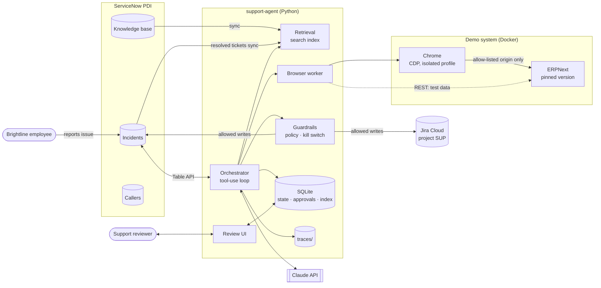
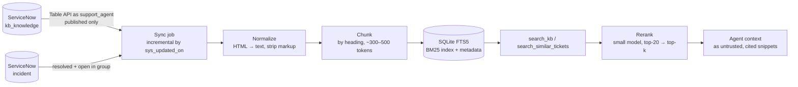
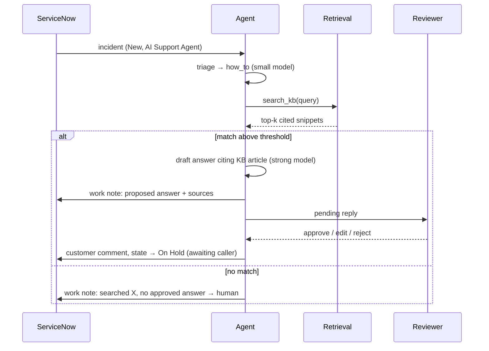
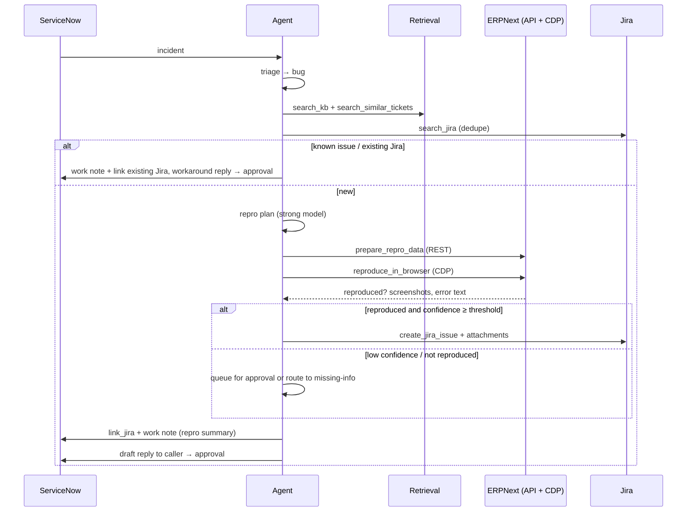
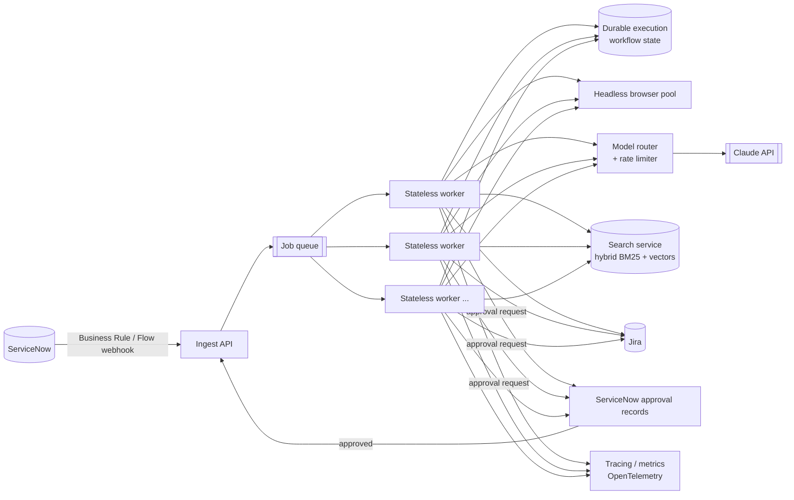

# Architecture

This document describes the V1 architecture of `support-agent`: the systems it connects, how it retrieves knowledge, how it reproduces bugs, the policies that constrain it, and how it evolves into a production deployment.

> **Status legend:** ✅ built · 🚧 in progress · 📋 planned

## 1. The scenario

A fictional company, **Brightline Supplies**, runs **ERPNext** (open-source ERP) for accounting. Its employees report problems to IT through **ServiceNow**. Engineering tracks real defects in **Jira**. Support answers questions from a **knowledge base**.

`support-agent` plays the role of an L1/L2 support engineer on that queue:

| System | Role in the scenario | Agent access |
|---|---|---|
| **ServiceNow** (PDI) | System of record for incidents, callers, and the KB | Table API, as `support_agent` |
| **ERPNext** (Docker) | The business application users report problems about. The **demo system** where bugs are reproduced | Browser via CDP (UI) + REST API (test-data setup) |
| **Jira Cloud** | Engineering backlog for confirmed defects | REST API |
| **Knowledge base** | Curated how-to and known-issue articles (ServiceNow KB) | Table API → local search index |
| **Claude API** | Triage (small model) and reasoning/drafting (strong model) | Messages API with tool use |

Seed tickets are closed ERPNext GitHub issues (label `accounts`), rewritten as end-user reports from fictional callers. See [SERVICENOW.md](SERVICENOW.md).

## 2. Design principles

1. **APIs for systems of record, CDP only for what the user sees.** ServiceNow and Jira are accessed only through their REST APIs. ERPNext test data is prepared through its REST API. The browser is used only to reproduce what the user saw in ERPNext's UI.
2. **The model proposes, the policy decides.** The LLM chooses tools and drafts content. A deterministic policy layer decides whether an action runs, waits for approval, or is refused.
3. **Narrow, typed tools.** Each tool does one thing, validates input with a schema, and returns structured output. No generic HTTP, SQL, or shell tools.
4. **Untrusted input stays data.** Ticket text, KB content, Jira content, and web page content are never treated as instructions.
5. **Grounded answers or no answer.** Customer-facing answers must cite a KB article. With no good match, the agent escalates instead of improvising.
6. **Separate identities per purpose.** The agent, the data seeder, and the human admin use different accounts in every system.
7. **Everything is traceable and idempotent.** Every run produces a trace. Every write is keyed so retries never double-reply or duplicate a Jira issue.
8. **Simple first, scalable later.** V1 is a single Python process plus containers. Component boundaries are drawn so each piece can become a service.

## 3. System context

## 4. Components

| Component | Location | Responsibility | Status |
|---|---|---|---|
| **ServiceNow setup** | `scripts/servicenow_setup.py` | Idempotent provisioning of groups, service accounts, and scoped KB | ✅ |
| **Seeder** | `scripts/seed_incidents.py`, `data/seed/` | Loads synthetic callers and incidents as `seed_loader` | ✅ |
| **Queue poller** | `src/agent/` | Polls incidents assigned to *AI Support Agent* that changed since the last cursor | 📋 |
| **Orchestrator** | `src/agent/` | Per-ticket loop: triage → research → plan → act → disposition. Enforces step, token, and time budgets | 📋 |
| **Model router** | `src/agent/` | Small model for triage/classification. Strong model for reasoning, drafting, repro planning | 📋 |
| **Retrieval** | `src/tools/` + SQLite | Syncs KB articles and resolved incidents into a local search index. Serves `search_kb` and `search_similar_tickets` (§5) | 📋 |
| **Typed tools** | `src/tools/` | One module per tool, with Pydantic input/output schemas | 📋 |
| **ServiceNow client** | `src/tools/` | Incidents, journal entries (work notes, comments), KB, callers | 📋 |
| **Jira client** | `src/tools/` | Search (JQL), create, comment, attach | 📋 |
| **ERPNext client** | `src/tools/` | REST API for creating repro test data (fixtures) only | 📋 |
| **Browser worker** | `src/tools/` | Drives Chrome over CDP against ERPNext: login, navigate, click, type, screenshot, collect errors | 📋 |
| **Guardrails** | `src/guardrails/` | Autonomy policy, injection screening, argument validation, URL allow-list, idempotency, kill switch | 📋 |
| **Review UI** | `src/review_ui/` | Local page to approve, edit, or reject pending actions | 📋 |
| **State store** | SQLite | Poll cursor, runs, approvals, idempotency keys, search index | 📋 |
| **Trace writer** | `src/agent/` | `traces/<ticket>/<run_id>/trace.json` + screenshots | 📋 |
| **Demo system** | `demo_app/` | Docker Compose for a pinned ERPNext + fixtures for the fictional company | 📋 |
| **Evals** | `evals/` | Golden tickets, runner, scoring | 📋 |

### Tool catalogue

| Tool | System | Side effect | Default policy |
|---|---|---|---|
| `get_ticket(number)` | ServiceNow | read | auto |
| `search_kb(query, k)` | local index (ServiceNow KB) | read | auto |
| `search_similar_tickets(query, k)` | local index (ServiceNow incidents) | read | auto |
| `search_jira(query)` | Jira | read | auto |
| `prepare_repro_data(scenario)` | ERPNext REST | demo-system write (isolated) | auto |
| `reproduce_in_browser(steps, expected)` | ERPNext UI via CDP | browser (sandboxed) | auto |
| `add_work_note(ticket, text)` | ServiceNow | internal write | auto |
| `draft_reply(ticket, text, citations)` | ServiceNow | pending reply | approval before send |
| `update_state(ticket, state)` | ServiceNow | write | auto for `In Progress` / `On Hold`. Resolve and close are **refused** |
| `create_jira_issue(summary, steps, evidence)` | Jira | external write | auto if confidence ≥ threshold, else approval |
| `link_jira(ticket, issue_key)` | ServiceNow + Jira | write | auto |

## 5. Retrieval

Retrieval answers three different questions, each with its own source:

| Question | Source | Tool | Used for |
|---|---|---|---|
| *"Is there an approved answer?"* | ServiceNow KB, the agent's knowledge base only | `search_kb` | How-to answers with citation, known-issue workarounds |
| *"Have we seen this before?"* | ServiceNow incidents: resolved (for answers) and open (for duplicates) | `search_similar_tickets` | Duplicate detection, past resolutions as hints |
| *"Is engineering already tracking it?"* | Jira project | `search_jira` | Jira dedupe before creating an issue |

### 5.1 Indexing pipeline

- **Sync identity = agent identity.** The sync runs as `support_agent`, so the index contains exactly what ServiceNow ACLs and KB user criteria allow the agent to read. Access control is inherited, not re-implemented.
- **Incremental.** Only records with `sys_updated_on` newer than the last sync are fetched. Retired or unpublished articles are removed from the index.
- **Chunk metadata:** source (`kb` / `incident`), number (`KB0010001` / `INC0010005`), article version, title, ERPNext module and version tags, URL, updated time.
- **Search:** SQLite FTS5 (BM25), built into Python with no extra service. Top 20 candidates are **reranked** by the small model for semantic relevance. Then a **relevance threshold** applies: below it, the result is "no match".
- **Embeddings later.** Vector search (e.g. `sqlite-vec` + an embeddings provider) is a drop-in upgrade behind the same tool interface, to be added if evals show BM25 + rerank recall is insufficient.

### 5.2 Using retrieved content

- Snippets enter the prompt inside delimited `<retrieved_document source=... id=...>` blocks, labeled as untrusted data.
- Customer replies must cite at least one `KB…` number. The policy layer rejects a draft reply whose citations aren't in the retrieved set.
- Resolved incidents are **hints, not sources.** They can point to the right KB article or suggest a workaround, but they are never quoted to a customer.
- No match above the threshold → no answer. The agent writes a work note listing what it searched and routes the ticket to a human.

### 5.3 KB content

- Synthetic ERPNext how-to and known-issue articles, provided separately and loaded by a KB seeder (as `seed_loader`) into the agent's knowledge base.
- Articles carry ERPNext version applicability, so the agent doesn't apply a v15 workaround to a v16 problem.
- Out of scope for V1: the official ERPNext documentation site and the instance's demo KBs. One curated source keeps answers auditable.

## 6. Bug reproduction in ERPNext

### 6.1 Demo system

- **ERPNext in Docker** (official `frappe_docker` images), **pinned to a version that predates the fixes** for the seeded bugs. The seed tickets are closed upstream issues, so a current release won't reproduce them.
- **Fixtures via REST API** (`prepare_repro_data`): the fictional company "Brightline Supplies", currencies (INR, USD, KWD), suppliers, accounts, item tax templates. Fixtures are created as a dedicated ERPNext API user, never Administrator.
- **Isolation:** each repro run creates uniquely named records (prefix `REPRO-<run_id>`). A database snapshot can be restored to reset the site between demo sessions.

### 6.2 Reproduction flow

1. The strong model turns the ticket into a **structured repro plan**: preconditions (data needed), UI steps, expected result, and failure signal (error text, wrong status value).
2. `prepare_repro_data` creates the preconditions through the ERPNext API.
3. `reproduce_in_browser` logs in as the repro user and executes the UI steps over CDP. It captures:
   - screenshots at each step and at failure
   - ERPNext error dialogs (DOM text), console errors, and failed network responses (Frappe returns validation errors as `417` with a message)
4. The result is `reproduced` / `not_reproduced` / `blocked`, with observations and evidence paths, all written to the trace.

### 6.3 Browser guardrails

- Chrome runs in its own container with a **dedicated profile** and no saved credentials except the repro user's session.
- A CDP request interceptor **blocks every origin except the ERPNext demo URL**.
- The agent **never navigates to URLs from tickets.** It always starts from the configured ERPNext base URL.
- The repro user has a limited ERPNext role (e.g. *Accounts User*), not System Manager.

## 7. Jira integration

| Aspect | Design |
|---|---|
| Project | `SUP`, issue type Bug |
| Content | Summary, steps to reproduce, expected vs actual, environment (ERPNext version), evidence (screenshots attached), link to the ServiceNow incident |
| Labels | `support-agent`, `snow-INC00100xx`, ERPNext module (e.g. `accounts`) |
| Dedupe | Before creating: JQL search by label `snow-<incident>`, then by summary similarity among open issues. A match means comment and link instead of creating a new issue |
| Back-link | Jira key and URL stored on the incident (work note now, plus a dedicated `u_jira_issue` field, 📋) and in the agent's state DB |
| Idempotency | Key `(incident, "create_jira")` stored before the API call, checked on retry |
| Autonomy | Auto-create only when **reproduced** and confidence ≥ `JIRA_AUTO_CONFIDENCE`. Otherwise it goes to the review UI |

## 8. Data flow by ticket type

### 8.1 How-to → KB answer (e.g. INC0010009, INC0010010)

### 8.2 Missing info → ask the caller (e.g. INC0010003)

1. Triage flags missing essentials: which document or screen, steps, ERPNext version, the exact error.
2. The agent drafts **one** concise question listing exactly what it needs.
3. The reply goes to approval. Once sent, state is set to *On Hold – Awaiting Caller*.
4. When the caller responds, the incident changes, gets re-polled, and is triaged again.

### 8.3 Bug → reproduce → Jira (e.g. INC0010005, INC0010006)

### 8.4 Duplicate

If `search_similar_tickets` finds an open incident above the similarity threshold, or `search_jira` finds a matching open issue, the agent adds a work note linking the original, links the existing Jira issue, and creates nothing new.

## 9. Identities and access

| System | Account | Used by | Access | Credentials |
|---|---|---|---|---|
| ServiceNow | `admin` | Human, setup script | Full. API exception role only during setup | `.env.admin` |
| ServiceNow | `support_agent` | Agent | API only (WSAO). `itil` via group *AI Support Agent*. Reads only its knowledge base | `.env` |
| ServiceNow | `seed_loader` | Seeder scripts | API only (WSAO). `itil` + `user_admin` via group *Seed Data Loaders* | `.env` |
| ServiceNow | callers | Seed data | No roles, no login | none |
| ERPNext | Administrator | Human only | Full | password manager |
| ERPNext | `repro_bot` 📋 | Browser worker | UI login, limited role (Accounts User) | `.env` |
| ERPNext | `erp_fixtures` 📋 | `prepare_repro_data` | API key/secret, scoped to fixture doctypes | `.env` |
| Jira | agent account 📋 | Agent | API token, project `SUP` only | `.env` |
| Anthropic | API key 📋 | Agent | Spend-limited key | `.env` |

All secrets live only in gitignored `.env` files and are redacted from traces.

## 10. Autonomy and guardrail policy

The policy is declarative (`src/guardrails/`) and evaluated **outside** the model:

| Action | Mode | Notes |
|---|---|---|
| Classify, search, read | auto | |
| Prepare repro data in ERPNext | auto | Demo system only, uniquely named records |
| Reproduce in browser | auto | ERPNext origin only |
| Work note | auto | Internal only |
| Customer reply | approval | Must cite retrieved KB. Reviewer can edit |
| Jira create | conditional | Auto if reproduced and confidence ≥ `JIRA_AUTO_CONFIDENCE`, else approval |
| Resolve / close | **forbidden** | Humans only |
| Any write while kill switch is on | **forbidden** | Read and draft only |

**Kill switch:** `AGENT_KILL_SWITCH=true` (env) or a runtime flag file, checked before every write.
**Budgets:** max steps, tokens, and wall-clock time per run. Hitting a limit ends the run with a work note and hands the ticket to a human.

## 11. Security model

| Threat | Mitigation |
|---|---|
| **Prompt injection in ticket text** | Delimited untrusted-data blocks. Deterministic policy outside the model. Heuristic injection screen flags tickets for review. No destructive tools exist |
| **Injection via KB, Jira, or page content** | Treated the same as ticket text. Page text is summarized as observations, never executed |
| **Malicious URLs in tickets** | Browser starts only from the configured ERPNext URL. Interceptor blocks all other origins |
| **Browser compromise or data leakage** | Separate container and profile, demo system only, synthetic data only |
| **Over-privileged credentials** | Separate least-privilege accounts per purpose (§9). No admin use at runtime |
| **Secret leakage** | Secrets only in `.env` (gitignored). Traces redact auth headers and tokens |
| **Duplicate or replayed actions** | Idempotency key per `(ticket, action, content hash)`. Jira dedupe search |
| **Runaway agent** | Budgets, rate limits, kill switch |
| **Ungrounded answers** | Citation required and validated against the retrieved set. No-match → escalate |

## 12. Observability

- **Per-ticket trace:** `traces/<ticket>/<run_id>/trace.json` holds an ordered list of events: model calls (model, tokens, latency, cost), retrieval queries and results (ids, scores), tool calls (input, output, policy decision), approvals, errors. Screenshots are stored alongside.
- **Run summary:** one line per run with disposition, duration, cost, and actions taken.
- **ServiceNow-visible audit:** every agent action leaves a work note, so humans see the agent's reasoning in the ticket's activity stream.

## 13. Evaluation

- **Golden set:** the 10 seed incidents plus 10–20 more (duplicates, prompt-injection attempts, non-reproducible bugs), each labeled in `data/seed/` or `evals/golden/` with expected type, KB article, escalation, and forbidden actions.
- **Metrics:** routing accuracy · KB retrieval hit@k · citation validity · correct escalation (Jira exactly when expected) · repro success rate · **unsafe actions = 0** (hard gate).
- **Execution:** offline by default against mocked ServiceNow/Jira/ERPNext clients (deterministic, free). Optional live mode against the PDI and demo ERPNext.
- **CI:** safety gate + fast subset on every PR.

## 14. Production architecture

V1 runs as one process to stay demoable. Production keeps the same tools and policy but changes the runtime around them.

| Concern | V1 | Production |
|---|---|---|
| **Ingest** | Polling the Table API | Business Rule / Flow Designer → webhook → ingest API. Polling kept as a reconciliation fallback |
| **Work distribution** | In-process loop | Job queue (SQS / Pub/Sub / Redis Streams). One message per ticket change, deduped by `sys_id + sys_mod_count` |
| **Workers** | Single process | Stateless workers that scale horizontally |
| **Long waits (approvals)** | SQLite pending table | Durable execution (e.g. Temporal): a run pauses for hours and resumes exactly once |
| **Retrieval** | SQLite FTS5 + LLM rerank | Managed hybrid search (BM25 + vectors), event-driven KB sync, per-tenant indexes |
| **Browser** | One local Chrome | Headless browser pool, one context per job, network-isolated to allow-listed apps |
| **Demo/target app** | Pinned ERPNext in Docker | Customer's staging environment, never production, through a dedicated repro tenant |
| **Models** | Two fixed models | Routing by step and difficulty, fallback model, prompt caching, per-tenant budgets |
| **Rate limits and retries** | Basic backoff | Token buckets per API, backoff with jitter, circuit breakers, dead-letter queue |
| **Approvals** | Local review UI | Native ServiceNow approvals or UI actions, where reviewers already work |
| **Auth** | Basic Auth (WSAO accounts) | OAuth 2.0 client credentials, short-lived tokens, secret manager |
| **Observability** | JSON traces | OpenTelemetry, dashboards (deflection rate, approval rate, cost per ticket), alerting |

### Deployment path

1. **Docker Compose:** agent, review UI, browser, ERPNext, all with one command.
2. **Cloud Run / ECS Fargate:** same containers, managed queue and Postgres.
3. **Kubernetes:** autoscaling browser pools, multi-tenant isolation, network policies.

## 15. Trade-offs

| Decision | Benefit | Cost |
|---|---|---|
| ERPNext as demo system (vs custom demo app) | Real, complex enterprise app with real bugs, which is credible for hiring audiences | Heavier to run (several containers). Version pinning needed for closed bugs |
| Seed tickets from real closed issues | Realistic language and bugs with known ground truth | Must run a pre-fix ERPNext version. Some bugs need specific data or currency setups |
| Polling over webhooks in V1 | Works on a PDI without inbound networking | Latency and extra API calls |
| SQLite FTS5 + LLM rerank over vector DB | Zero extra services, inspectable, good on keyword-heavy ERP text (doctype names, error strings) | Weaker on paraphrases. Embeddings are a planned drop-in |
| Index synced as the agent identity | ACLs inherited automatically | Index must be rebuilt if agent permissions change |
| Single process + SQLite | Trivial to run and reason about | No horizontal scale. Boundaries kept clean for migration |
| Local review UI over ServiceNow approvals | Fast to build, no PDI customization | Reviewers leave their usual tool |
| Raw CDP over a high-level framework | Explicit control over interception and evidence capture | More code than Playwright |
| Narrow tools | Auditable, easy to guard and test | New capability = new tool, by design |
| Confidence-gated Jira auto-create | Less reviewer load for clear bugs | Needs calibration through evals |

## 16. Open questions

| # | Question | Proposed default |
|---|---|---|
| 1 | Which ERPNext version to pin? The seed bugs span v15 and v16 fixes | Pick the version that reproduces the most seed bugs. Mark the others `not_reproducible_in_demo` (still a valid eval path) |
| 2 | Rename KB "Customer Portal Support" now that the demo system is ERPNext? | Rename to **"ERPNext Support"** via the setup script |
| 3 | Store the Jira key on the incident in a custom field? | Add `u_jira_issue` via setup script (admin). Work note in the meantime |
| 4 | Embeddings provider, if needed | Decide after the retrieval eval (§13) |
